# How to use these notes

These notes form a self-contained study unit on one of the most useful algorithms of computational quantum mechanics [@Numerov24; @Blatt67; @KM; @Thijssen]. Each of the three physical problems is treated in exactly the same order, so that the student can see how the same tool is adapted to different physics:

1. **Physics and analytical solution** — the exact result we will test against.
2. **Numerical scheme** — the discretised equations, boundary conditions and the algorithmic strategy (shooting, matching, scattering).
3. **Logic chart** — a flowchart of the program.
4. **Codes** — complete Python 3 and Fortran 90 programs. Both versions implement the same algorithm and give the same numbers to all printed digits.
5. **Results, normalisation and verification.**
6. **Error analysis and convergence plots.**

Units used throughout: $\hbar = m = 1$ (and $\omega = 1$ for the oscillator). The time-independent Schrödinger equation [@Griffiths, ch. 2; @Sakurai] then reads

$$
-\frac{1}{2}\,\psi''(x) + V(x)\,\psi(x) = E\,\psi(x)
\quad\Longleftrightarrow\quad
\psi''(x) = -k^2(x)\,\psi(x),\qquad k^2(x) = 2\,[E - V(x)] .
$$

In regions where $E > V$ (classically allowed) $k^2 > 0$ and $\psi$ oscillates; where $E < V$ (classically forbidden) $k^2 < 0$ and $\psi$ grows or decays exponentially. This sign change is the source of most of the practical difficulties discussed below.

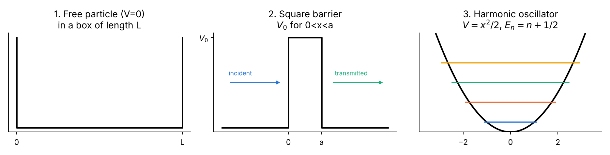{width=100%}

**Software.** Python 3 with NumPy [@NumPy] and Matplotlib; any Fortran 90 compiler (e.g. `gfortran`) [@MRC]. Compile and run each Fortran program with

```bash
gfortran -O2 -o p1 p1_free_particle.f90 && ./p1
gfortran -O2 -o p2 p2_square_barrier.f90 && ./p2
gfortran -O2 -o p3 p3_harmonic_oscillator.f90 && ./p3
python3 plot_fortran_results.py      # plots the .dat files written by the Fortran codes
```

and each Python program with `python3 p1_free_particle.py` etc.

# Part I — The Numerov method

## The mathematical problem

Numerov's method [@Numerov24; @Numerov27] integrates second-order linear ODEs **without a first-derivative term**,

$$
y''(x) = -g(x)\,y(x) + s(x),
$$

which is exactly the structure of the one-dimensional (or radial) Schrödinger equation with $g = k^2$, $s = 0$. It is a three-point, two-step, **fourth-order** method that costs essentially the same as the simplest second-order finite-difference scheme [@Blatt67; @KM; @Thijssen, app. A].

## Derivation

Introduce a uniform grid $x_n = x_0 + n h$ and write $y_n = y(x_n)$. Taylor-expand forwards and backwards (the derivation follows [@KM; @Giannozzi]):

$$
y_{n\pm1} = y_n \pm h y'_n + \frac{h^2}{2} y''_n \pm \frac{h^3}{6} y'''_n + \frac{h^4}{24} y^{(4)}_n \pm \frac{h^5}{120} y^{(5)}_n + \frac{h^6}{720} y^{(6)}_n + \dots
$$

Adding the two expansions, **all odd derivatives cancel**:

$$
y_{n+1} - 2y_n + y_{n-1} = h^2 y''_n + \frac{h^4}{12} y^{(4)}_n + \frac{h^6}{360} y^{(6)}_n + O(h^8).
$$

Truncating after $h^2 y''_n$ gives the ordinary second-order central difference. Numerov's trick is to keep the $h^4$ term and *eliminate* the fourth derivative by applying the same central difference to $y''$ itself:

$$
y^{(4)}_n = \frac{y''_{n+1} - 2y''_n + y''_{n-1}}{h^2} - \frac{h^2}{12} y^{(6)}_n + O(h^4).
$$

Substituting this into the previous equation:

$$
y_{n+1} - 2y_n + y_{n-1} = \frac{h^2}{12}\left( y''_{n+1} + 10\,y''_n + y''_{n-1}\right) - \frac{h^6}{240}\,y^{(6)}_n + O(h^8).
$$

Now use the differential equation, $y'' = -g\,y$, at the three nodes. Collecting the unknown $y_{n+1}$ on the left gives the **Numerov recursion**:

$$
\boxed{\;
y_{n+1}\left(1 + \frac{h^2}{12} g_{n+1}\right) = 2\,y_n\left(1 - \frac{5h^2}{12} g_n\right) - y_{n-1}\left(1 + \frac{h^2}{12} g_{n-1}\right)
\;}
$$

With the abbreviation $c_n = 1 + h^2 g_n/12$ this is written compactly — and this is literally the line that appears in every code of this unit —

$$
y_{n+1} = \frac{(12 - 10\,c_n)\,y_n - c_{n-1}\,y_{n-1}}{c_{n+1}} .
$$

The same formula run "backwards" (solve for $y_{n-1}$) integrates from right to left; this is used in Problems 2 and 3.

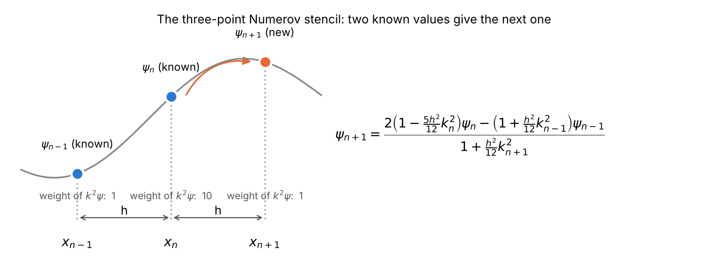{width=100%}

## Physical and geometrical interpretation

* The left-hand side $y_{n+1}-2y_n+y_{n-1}$ measures the **curvature** of $\psi$ on the grid. The Schrödinger equation says that curvature equals $-k^2\psi$: the wavefunction bends *towards* the axis where $E>V$ (oscillation) and *away* from it where $E<V$ (exponential behaviour).
* Plain finite differences evaluate that curvature only at the centre point. Numerov averages it with weights $1:10:1$ — a Simpson-like weighting — so that the leading error term cancels.
* Because the scheme is linear in $y$, the overall scale of the starting values is irrelevant: a wavefunction is defined up to a constant, which is fixed afterwards by **normalisation**.

## Error of the method

**Local truncation error** [@Blatt67]. One step commits an error

$$
\tau = -\frac{h^6}{240}\,\psi^{(6)}(x_n) + O(h^8).
$$

**Global error.** The local error is a defect in a *second-difference* equation. Dividing by $h^2$ it acts like a spurious source of size $\tau/h^2 = O(h^4)$ in $\psi''$, which, integrated twice over a fixed interval, produces a global error

$$
\varepsilon_{\text{global}} = O(h^4).
$$

Halving $h$ therefore reduces the error by $2^4 = 16$. The observed ratio 16 is the fingerprint we look for in all convergence tables of this unit.

**Starting-value error.** An error $\delta$ in the second starting value $y_1$ is equivalent to an error $\delta/h$ in the initial slope, which propagates to a global error $O(\delta/h)$. To keep fourth-order accuracy one needs $\delta = O(h^5)$. A first-order Taylor start $y_1 = y_0 + h y'_0$ has $\delta = O(h^3)$ and spoils the method down to $O(h^2)$ — demonstrated numerically in Problem 1.

**Phase (dispersion) error.** For constant $k$ the exact discrete solution of the constant-coefficient recurrence [@Elaydi, ch. 2] is $e^{\pm i k_h x}$ with

$$
\cos(k_h h) = \frac{1 - \frac{5}{12}(kh)^2}{1 + \frac{1}{12}(kh)^2}
\quad\Longrightarrow\quad
k_h = k\left[1 + \frac{(kh)^4}{480} + \dots\right].
$$

The numerical wave runs slightly faster than the true wave; after a distance $X$ the phase error is $k^5 h^4 X/480$. Rule of thumb: use at least 20–30 grid points per de Broglie wavelength.

**Round-off error** [@Goldberg91; @Higham, ch. 1–2]. Every step adds an error of order machine precision $\epsilon \approx 10^{-16}$ (IEEE double precision [@IEEE754]) times $|\psi|$. Accumulated over $N \propto 1/h$ steps of a second-order recursion, the round-off contribution grows roughly like $\epsilon/h^2$. Total error $\approx A h^4 + B\epsilon/h^2$ therefore has a minimum; below an optimal $h$ (here around $h\sim 10^{-3}$) refining the grid makes things *worse*. All convergence plots below show this floor at the level $10^{-11}$–$10^{-12}$.

## Strengths and faults (limitations) of the Numerov method

The method is elegant and accurate, *nevertheless* it has well-defined faults which every user must know [@Blatt67; @Thijssen; @Giannozzi]. Each of them is met — and cured — in one of the three problems.

| # | Fault / limitation | Consequence | Cure used in this unit |
|--|------------------|------------------|------------------|
| 1 | Only for $y'' = -g y + s$ (no $y'$ term) | Equations with first derivatives must first be transformed (e.g. $R(r)=u(r)/r$ in the radial problem) | All three problems already have this form |
| 2 | Not self-starting: needs $y_0$ **and** $y_1$ | An inaccurate $y_1$ degrades the order from 4 to 2 | Exact or asymptotic start values (Problem 1, Part A) |
| 3 | Assumes a smooth potential: $\psi^{(6)}$ must exist | A step in $V$ (barrier edge) drops the order to 2 | Edge nodes, one-sided $V$, jump correction (Problem 2) |
| 4 | Unstable when integrating **into** a classically forbidden region | Growing exponential $e^{+\kappa x}$ swamps the physical decaying one | Two-sided shooting with matching (Problem 3) |
| 5 | Requires $c_n = 1 + h^2 k_n^2/12 \neq 0$ | For deep forbidden regions with coarse $h$ the scheme breaks down | Choose $h$ so that $h^2 k^2 \gg -12$ (i.e. small in magnitude) |
| 6 | Uniform grid only | Singular or long-range potentials need very many points | (Logarithmic grid + change of variable — not needed here) |
| 7 | It is an *integrator*, not an eigenvalue solver | Energies must be found by shooting + root finding; levels can be missed | Energy scan + bisection + node counting (Problems 1, 3) |
| 8 | Round-off floor | Error stops decreasing for very small $h$ | Use $h$ near the optimum; Richardson extrapolation |
| 9 | Free-particle (continuum) states are not square-integrable | $\int\psi^*\psi\,dx$ diverges | Box normalisation (Problem 1) or flux normalisation (Problem 2) |

## How eigenvalues are found: the shooting idea

For a bound state the energy is unknown. We guess $E$, integrate from one boundary where $\psi$ is known, and check whether the other boundary condition is satisfied. The miss distance is a continuous function of $E$ whose zeros are the eigenvalues. They are bracketed by a coarse scan and refined by bisection, which halves the uncertainty in each step and cannot fail once a sign change is found [@KM, ch. 3; @NR, §9.1].

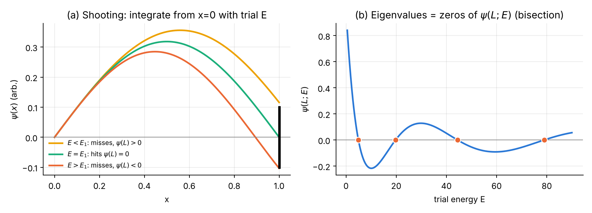{width=100%}

## Generic logic chart of the Numerov integrator

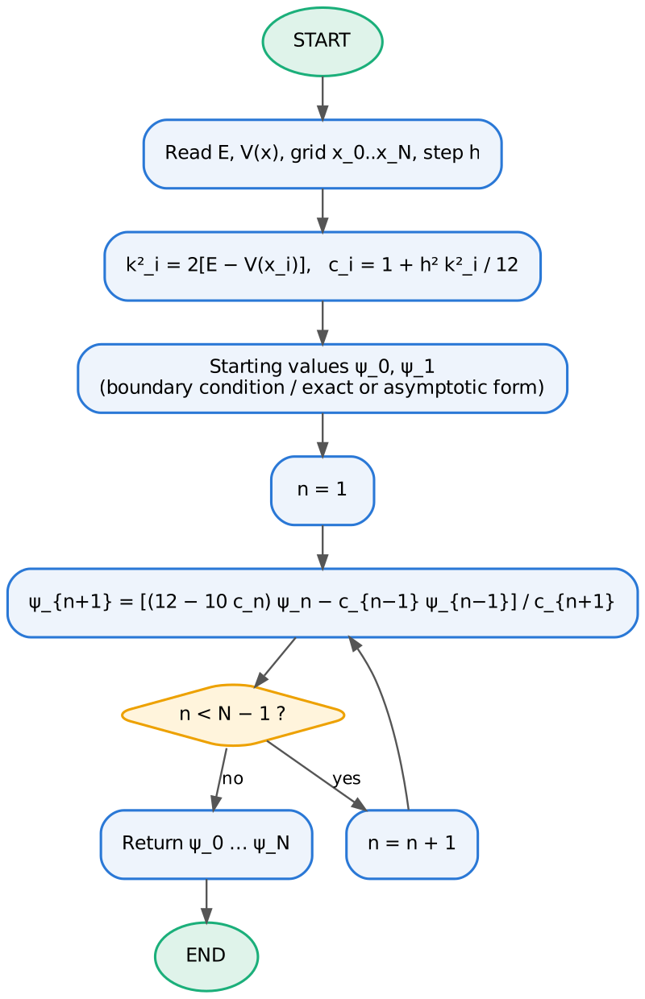{width=42%}

## Tools for verification and error analysis used throughout

**Normalisation** with the composite Simpson rule [@NR, §4.1] (error $O(h^4)$, consistent with Numerov):

$$
\int_{x_0}^{x_N} |\psi|^2 dx \approx \frac{h}{3}\left[\,|\psi_0|^2 + 4\sum_{\text{odd } n}|\psi_n|^2 + 2\sum_{\text{even } n}|\psi_n|^2 + |\psi_N|^2\right],\qquad \psi \leftarrow \frac{\psi}{\sqrt{\int|\psi|^2dx}} .
$$

**Observed order of convergence.** If $\varepsilon(h) \approx C h^p$ then $\log\varepsilon = \log C + p\log h$; $p$ is obtained as the least-squares slope of a log–log plot, or from two successive grids as $p = \log_2[\varepsilon(h)/\varepsilon(h/2)]$.

**Richardson extrapolation** [@Richardson27]. Knowing $p = 4$, two calculations with steps $h$ and $h/2$ are combined into an improved estimate

$$
E_R = \frac{2^4 E(h/2) - E(h)}{2^4 - 1} = \frac{16\,E(h/2) - E(h)}{15},
$$

which removes the leading $h^4$ error term.

**Other checks.** Orthogonality $\langle\psi_i|\psi_j\rangle = \delta_{ij}$, the virial theorem (Problem 3) and flux conservation $R+T=1$ (Problem 2).

# Part II — Problem 1: The free particle

## Physics and analytical solution

For $V(x)=0$ the Schrödinger equation is $\psi'' = -k^2\psi$ with $k = \sqrt{2E}$. Its general solution is

$$
\psi(x) = A e^{ikx} + B e^{-ikx} = C \sin kx + D\cos kx, \qquad E = \frac{k^2}{2}.
$$

Two separate questions are studied.

**Part A — the unbounded free particle (initial-value problem).** With $\psi(0)=0$ and a chosen $k$ the exact solution is $\psi(x) = \sin kx$ (amplitude fixed to 1). Such a state is **not normalisable** on the whole real line: $\int_{-\infty}^{\infty}|\psi|^2dx = \infty$. Continuum states are normalised either to a delta function, $\langle k|k'\rangle = \delta(k-k')$, or by confining the particle to a large box [@Sakurai, §1.6; @Griffiths, §2.4]. Part A therefore tests only the *accuracy* of the integration.

**Part B — free particle in a box $[0,L]$ (eigenvalue problem).** Imposing $\psi(0)=\psi(L)=0$ (infinite walls) quantises $k$ [@Griffiths, §2.2]:

$$
k_n = \frac{n\pi}{L},\qquad E_n = \frac{n^2\pi^2}{2L^2},\qquad \psi_n(x) = \sqrt{\frac{2}{L}}\,\sin\frac{n\pi x}{L},\qquad n = 1,2,3,\dots
$$

These functions are normalised, $\int_0^L\psi_n^2dx = 1$, and orthogonal. We use $L=1$, so $E_1 = \pi^2/2 = 4.934802200545\ldots$

## Numerical scheme

* Grid: $x_j = j h$, $h = L/N$, $j = 0,\dots,N$; $k^2_j = 2E$ (constant).
* **Part A.** Starting values $\psi_0 = 0$ and either the exact $\psi_1 = \sin kh$ or the Taylor approximation $\psi_1 = kh$ (error $k^3h^3/6$). Integrate forward to $X = 10$ and record $\max_j|\psi_j - \sin kx_j|$ for $N = 25 \ldots 3200$.
* **Part B.** For a trial $E$: $\psi_0 = 0$, $\psi_1 = \eta$ (any small number — the scale is irrelevant), integrate to $x_N = L$. The eigenvalue condition is
$$F(E) \equiv \psi_N(E) = 0 .$$
Scan $E$ to find a sign change of $F$, refine by bisection to relative tolerance $10^{-13}$, integrate once more at the converged $E$, normalise with Simpson, fix the arbitrary sign, and compare with the exact $\psi_n$.

## Logic chart

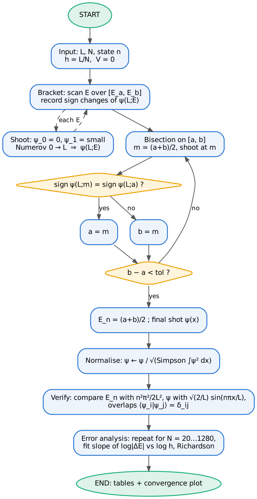{width=55%}

## Python 3 code

{{CODE:python:../../python/p1_free_particle.py}}

## Fortran 90 code

{{CODE:fortran:../../fortran/p1_free_particle.f90}}

## Results, normalisation and verification

**Part A — accuracy of the integration ($k=2$, $X=10$, i.e. about 3 wavelengths).**

| N | h | error (exact start) | ratio | error (Taylor start) | ratio |
|---:|---:|---:|---:|---:|---:|
| 25 | 0.400 | 1.55e-02 | — | 1.14e-01 | — |
| 50 | 0.200 | 1.01e-03 | 15.4 | 2.71e-02 | 4.2 |
| 100 | 0.100 | 6.29e-05 | 16.1 | 6.69e-03 | 4.1 |
| 200 | 0.050 | 3.92e-06 | 16.0 | 1.67e-03 | 4.0 |
| 400 | 0.025 | 2.46e-07 | 16.0 | 4.17e-04 | 4.0 |
| 800 | 0.0125 | 1.53e-08 | 16.0 | 1.04e-04 | 4.0 |
| 1600 | 0.00625 | 9.50e-10 | 16.1 | 2.60e-05 | 4.0 |
| 3200 | 0.00313 | 5.40e-11 | 17.6 | 6.51e-06 | 4.0 |

Fitted orders: $p = 4.01$ with the exact start, $p = 2.01$ with the Taylor start — exactly as predicted by the starting-value analysis of Part I (fault no. 2).

**Part B — box of length $L=1$, $N=200$ ($h=0.005$).**

| n | Eₙ Numerov | Eₙ exact | rel. error | ∫ψ²dx | max\|ψ − ψₑₓ\| |
|---:|---:|---:|---:|---:|---:|
| 1 | 4.934802199274 | 4.934802200545 | 2.6e-10 | 1.000000000000 | 1.6e-11 |
| 2 | 19.739208722038 | 19.739208802179 | 4.1e-09 | 1.000000000000 | 1.3e-11 |
| 3 | 44.413218892273 | 44.413219804902 | 2.1e-08 | 1.000000000000 | 5.4e-12 |
| 4 | 78.956830080506 | 78.956835208715 | 6.5e-08 | 1.000000000000 | 4.3e-12 |

The overlap matrix $\langle\psi_i|\psi_j\rangle$ equals the identity to within $5\times10^{-12}$: the numerical eigenfunctions are normalised and mutually orthogonal, as eigenfunctions of a Hermitian operator must be. The relative energy error grows like $n^4$ because the error constant contains $k^4 h^4$ — higher states have shorter wavelengths and are resolved by fewer points.

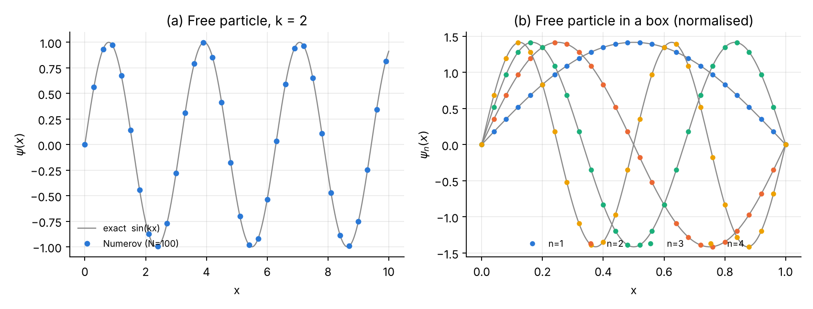{width=100%}

## Error analysis and convergence

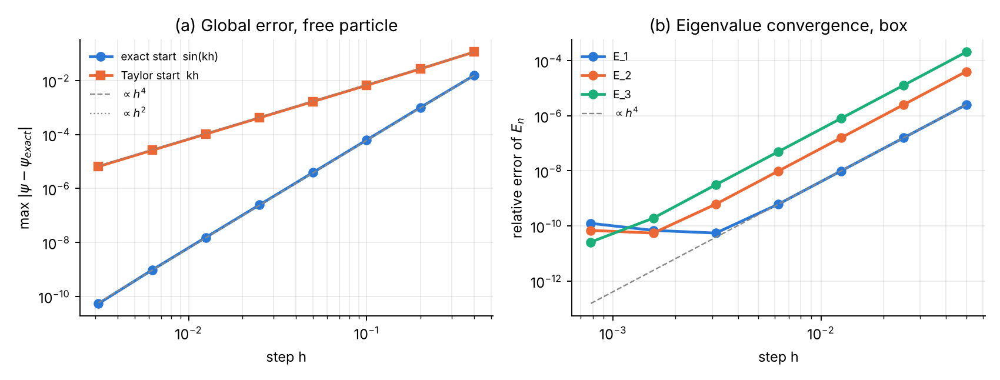{width=100%}

Observations:

* The eigenvalue errors fall with fitted orders 3.90, 4.00, 4.00 for $n = 1,2,3$.
* For $E_1$ the error stops decreasing below $h \approx 3\times10^{-3}$ and then grows slightly: this is the **round-off floor** (fault no. 8).
* **Richardson extrapolation** from $N=40$ and $N=80$: $E(h)=4.934801417973$, $E(h/2) = 4.934802151642$ give $E_R = 4.934802200554$, error $9\times10^{-12}$ — better than a direct calculation with 16 times more points.

# Part III — Problem 2: The square potential barrier

## Physics and analytical solution

$$
V(x) = \begin{cases} V_0, & 0 < x < a\\ 0, & \text{otherwise}\end{cases}\qquad V_0 = 5,\ a = 1 .
$$

A particle of energy $E>0$ arrives from the left. The solution in the three regions is

$$
\psi(x) = \begin{cases}
A e^{ikx} + B e^{-ikx}, & x<0 \quad (\text{incident} + \text{reflected})\\
C e^{\kappa x} + D e^{-\kappa x}, & 0<x<a \quad (E<V_0,\ \kappa=\sqrt{2(V_0-E)})\\
F e^{ikx}, & x>a \quad (\text{transmitted only})
\end{cases}
\qquad k = \sqrt{2E}.
$$

For $E > V_0$ replace $\kappa \to i q$ with $q = \sqrt{2(E-V_0)}$. Continuity of $\psi$ and $\psi'$ at $x=0$ and $x=a$ gives four linear equations; eliminating $B, C, D$ yields the transmission and reflection coefficients [@Merzbacher, ch. 6; @Messiah, ch. III; @Griffiths, §2.6]

$$
T = \left|\frac{F}{A}\right|^2 =
\begin{cases}
\left[1 + \dfrac{V_0^2\sinh^2(\kappa a)}{4E(V_0-E)}\right]^{-1}, & E < V_0 \quad\text{(tunnelling)}\\[3ex]
\left[1 + \dfrac{V_0^2\sin^2(q a)}{4E(E-V_0)}\right]^{-1}, & E > V_0
\end{cases}
\qquad R = \left|\frac{B}{A}\right|^2 = 1 - T .
$$

At $E = V_0$ both formulas tend to $T = (1 + V_0 a^2/2)^{-1}$. Above the barrier, **transmission resonances** $T=1$ occur when $qa = n\pi$, i.e. $E = V_0 + n^2\pi^2/2a^2$; the first one is $E = 9.9348$.

**Normalisation of a scattering state.** $\psi$ is not square-integrable, so the normalisation is fixed by the *incident amplitude* ($A=1$) and the meaningful check is conservation of the probability current [@Merzbacher, ch. 6]
$$ j = \frac{1}{2i}\left(\psi^*\psi' - \psi\psi^{*\prime}\right),\qquad j_{\text{inc}} = j_{\text{refl}} + j_{\text{trans}} \;\Longleftrightarrow\; R + T = 1 .$$

## Numerical scheme

* **Backward integration** [@Thijssen, ch. 2; @KM, ch. 3]. Because the solution on the right contains only one wave, we fix $F = 1$ and start there:
$$\psi_N = e^{ikx_N},\qquad \psi_{N-1} = e^{ikx_{N-1}} \quad(\text{exact starting values}).$$
The recursion is run backwards with **complex** arithmetic,
$$\psi_{j-1} = \frac{(12-10c_j)\,\psi_j - c_{j+1}\psi_{j+1}}{c_{j-1}},\qquad j = N-1,\dots,1 .$$
No energy search is needed: every $E>0$ is allowed (continuous spectrum).
* **Extracting $A$ and $B$.** On the two leftmost nodes, which lie in the free region,
$$\begin{pmatrix} e^{ikx_0} & e^{-ikx_0}\\ e^{ikx_1} & e^{-ikx_1}\end{pmatrix}\begin{pmatrix}A\\B\end{pmatrix} = \begin{pmatrix}\psi_0\\ \psi_1\end{pmatrix}, \qquad T = \frac{1}{|A|^2},\quad R = \frac{|B|^2}{|A|^2}.$$
* **The discontinuity (fault no. 3).** Numerov's $O(h^4)$ accuracy assumes that $\psi^{(6)}$ exists. At a step in $V$, $\psi''$ jumps and $\psi'''$ jumps by $-[k^2]\psi'$. Three treatments are compared:
    1. *misaligned grid* — the edges fall inside a cell;
    2. *aligned grid* — the edges are grid nodes and $V$ there is set to the mean value $V_0/2$;
    3. *corrected scheme* — aligned grid, plus (a) every stencil centred **off** an edge uses the one-sided value of $V$ at a neighbouring edge node (the value on its own side), and (b) the stencil centred **on** an edge node $x_e$ receives the jump correction derived by repeating the Taylor expansion of Part I with one-sided derivatives:
$$\delta = -\frac{h^3}{12}\,[k^2]_e\,\psi'(x_e),\qquad [k^2]_e = k^2(x_e^+) - k^2(x_e^-),$$
added to the right-hand side of the recursion. $\psi'(x_e)$ is needed only to $O(h^2)$ and is taken from the already computed side: $\psi'(x_e) \approx (-3\psi_e + 4\psi_{e+1} - \psi_{e+2})/2h$.

Derivation of (b) in one line: with one-sided expansions, $\psi_{e+1}+\psi_{e-1}-2\psi_e$ contains the term $\frac{h^3}{6}(\psi'''_+-\psi'''_-)$, whereas the Numerov combination with $\bar V = V_0/2$ reproduces only $\frac{h^3}{12}(\psi'''_+-\psi'''_-)$. The difference $\frac{h^3}{12}[\psi'''] = -\frac{h^3}{12}[k^2]\psi'$ is a local $O(h^3)$ error which, by the argument of Part I, would give a global $O(h^2)$ error unless it is added back.

## Logic chart

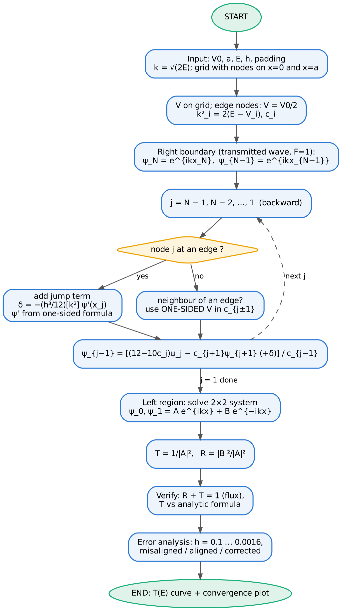{width=55%}

## Python 3 code

{{CODE:python:../../python/p2_square_barrier.py}}

## Fortran 90 code

{{CODE:fortran:../../fortran/p2_square_barrier.f90}}

## Results, normalisation and verification

Transmission for $V_0 = 5$, $a = 1$, $h = 0.01$, corrected scheme:

| E | T Numerov | T exact | \|ΔT\| | R | R + T − 1 |
|---:|---:|---:|---:|---:|---:|
| 0.5 | 0.0035743425 | 0.0035743427 | 1.8e-10 | 0.99642566 | -9.9e-11 |
| 1.0 | 0.0089257613 | 0.0089257617 | 3.8e-10 | 0.99107424 | -2.5e-10 |
| 2.5 | 0.0446653204 | 0.0446653217 | 1.3e-09 | 0.95533468 | -1.2e-09 |
| 4.0 | 0.1459692940 | 0.1459692993 | 5.3e-09 | 0.85403070 | -4.1e-09 |
| 4.9 | 0.2684067226 | 0.2684067332 | 1.1e-08 | 0.73159327 | -7.5e-09 |
| 5.1 | 0.3037780173 | 0.3037780296 | 1.2e-08 | 0.69622197 | -8.4e-09 |
| 6.0 | 0.4959493199 | 0.4959493430 | 2.3e-08 | 0.50405067 | -1.4e-08 |
| 8.0 | 0.9041154211 | 0.9041154557 | 3.5e-08 | 0.09588455 | -2.5e-08 |
| 9.935 | 0.9999999717 | 0.9999999995 | 2.8e-08 | 0.00000000 | -2.8e-08 |
| 12.0 | 0.9768235598 | 0.9768235914 | 3.2e-08 | 0.02317641 | -2.7e-08 |
| 15.0 | 0.9621790687 | 0.9621791216 | 5.3e-08 | 0.03782090 | -2.7e-08 |

Tunnelling ($E<V_0$) gives small but finite $T$; above the barrier $T$ oscillates and reaches 1 at the resonance $E \approx 9.935$.

{width=90%}

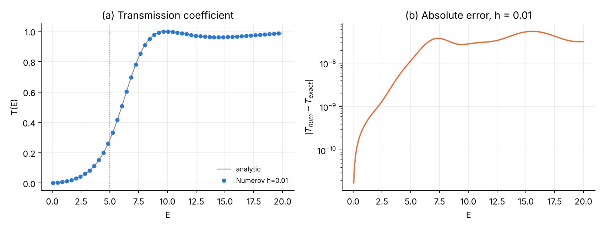{width=100%}

**An important lesson about the flux check.** With the *uncorrected* schemes, $R+T-1$ came out at the $10^{-14}$ level for every $h$, although $T$ itself was wrong by up to $10^{-4}$ (e.g. aligned grid, $h=0.01$, $E=4$: $|\Delta T| = 2.5\times10^{-5}$, $R+T-1 = 5\times10^{-14}$). The reason: the three-term Numerov recursion with real coefficients conserves a discrete Wronskian (Casoratian [@Elaydi, ch. 2]) *exactly*, so the discrete current is conserved whatever the discretisation error. **$R+T=1$ is a necessary consistency check, not a measure of accuracy.** Accuracy must be measured against the analytical $T$ or by grid refinement. (The corrected scheme couples four points at the two edge nodes and therefore conserves the current only to $O(h^4)$, which is why $R+T-1$ is of the same size as $\Delta T$ in the table above.)

## Error analysis and convergence

| h | misaligned E=2 | aligned V₀/2 E=2 | corrected E=2 | misaligned E=8 | aligned V₀/2 E=8 | corrected E=8 |
|---:|---:|---:|---:|---:|---:|---:|
| 0.1 | 8.9e-05 | 1.3e-04 | 8.4e-06 | 3.3e-03 | 6.1e-03 | 3.1e-04 |
| 0.05 | 2.3e-05 | 3.9e-05 | 5.4e-07 | 8.0e-04 | 1.6e-03 | 2.1e-05 |
| 0.025 | 5.7e-06 | 1.1e-05 | 3.4e-08 | 2.0e-04 | 3.9e-04 | 1.3e-06 |
| 0.0125 | 1.4e-06 | 2.8e-06 | 2.2e-09 | 5.0e-05 | 9.9e-05 | 8.5e-08 |
| 0.00625 | 3.6e-07 | 7.0e-07 | 1.4e-10 | 1.2e-05 | 2.5e-05 | 5.3e-09 |
| 0.003125 | 8.9e-08 | 1.8e-07 | 7.9e-12 | 3.1e-06 | 6.2e-06 | 3.2e-10 |
| 0.0015625 | 2.2e-08 | 4.4e-08 | 5.2e-12 | 7.8e-07 | 1.6e-06 | 5.9e-12 |
| **order** | **1.99** | **1.90** | **3.98** | **2.01** | **1.98** | **3.96** |

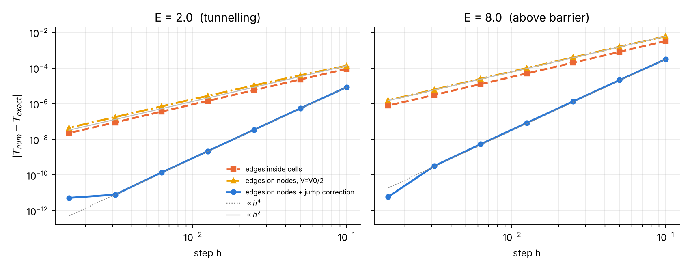{width=100%}

Conclusions: (i) a discontinuous potential is the most common way to lose the advertised accuracy of Numerov without noticing; (ii) simply placing the edge on a node and using $V_0/2$ does **not** help; (iii) with the one-sided-potential rule and the $h^3$ jump term the method is again fourth order, and at $h = 0.0125$ it is about 600 times more accurate than the naive scheme.

# Part IV — Problem 3: The quantum harmonic oscillator

## Physics and analytical solution

$$
V(x) = \tfrac{1}{2}x^2,\qquad \psi'' = -(2E - x^2)\,\psi .
$$

Square-integrable solutions exist only for [@Griffiths, §2.3; @Messiah, ch. XII; @DLMF, §18.3]

$$
E_n = n + \tfrac{1}{2},\qquad
\psi_n(x) = \frac{1}{\pi^{1/4}\sqrt{2^n n!}}\,H_n(x)\,e^{-x^2/2},\qquad n = 0,1,2,\dots
$$

with Hermite polynomials $H_0=1$, $H_1=2x$, $H_{n+1} = 2xH_n - 2nH_{n-1}$ [@DLMF, §18.9]. Useful exact properties for verification:

* normalisation and orthogonality $\langle\psi_m|\psi_n\rangle = \delta_{mn}$;
* $\psi_n$ has exactly $n$ nodes (oscillation theorem);
* **virial theorem** [@Sakurai, §2.3; @Griffiths, §2.3]: $\langle T\rangle = \langle V\rangle = E_n/2$;
* classical turning points $x_t = \pm\sqrt{2E}$; beyond them $\psi \sim e^{-x^2/2}$ decays.

## Numerical scheme

* Grid $x_j = -L + jh$, $h = 2L/N$, on a finite box $[-L, L]$ ($L = 7$ by default); boundary conditions $\psi(\pm L) = 0$, justified because $\psi_n(\pm L)$ is astronomically small.
* **Why not shoot from one side only (fault no. 4)?** Beyond the right turning point the general solution is a mixture of $e^{-x^2/2}$ (physical) and $e^{+x^2/2}$ (unphysical). Any error — round-off or an energy that is wrong by $10^{-6}$ — excites the growing solution, which dominates exponentially. Integrating from $-L$ all the way to $+L$ is therefore extremely ill-conditioned (Figure below, panel a).
* **Two-sided shooting** [@KM, ch. 3; @Giannozzi]. Integrate *outward* from $-L$ ($\psi_0 = 0$, $\psi_1 = \eta$) and *inward* from $+L$ ($\psi_N = 0$, $\psi_{N-1} = \eta$). In both directions we integrate from the forbidden region towards the allowed region, so the physically decaying solution is the *growing* one in the direction of integration — a stable process. The two pieces meet at the node $m$ nearest the right turning point.
* **Matching function.** The two pieces must be proportional to each other. Instead of matching logarithmic derivatives (which has poles where $\psi_m = 0$), we use the **discrete Wronskian** (Casoratian) [@Elaydi, ch. 2]
$$D(E) = \psi^L_{m+1}\psi^R_m - \psi^L_m\psi^R_{m+1}.$$
Because $u_j = c_j\psi_j$ satisfies $u_{j+1} + u_{j-1} = (12/c_j - 10)\,u_j$, the quantity $c_mc_{m+1}D$ is independent of $m$, and $D = 0$ holds **exactly** when the two discrete solutions coincide — i.e. at the eigenvalue of the discrete problem. $D(E)$ is smooth and has no poles, so a scan + bisection is robust.
* After convergence the pieces are glued at $m$, normalised with Simpson, the nodes are counted to identify $n$, and the sign is fixed.

{width=100%}

## Logic chart

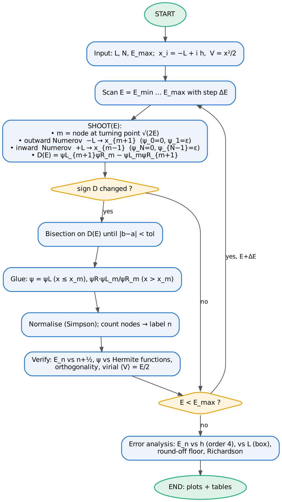{width=55%}

## Python 3 code

{{CODE:python:../../python/p3_harmonic_oscillator.py}}

## Fortran 90 code

{{CODE:fortran:../../fortran/p3_harmonic_oscillator.f90}}

## Results, normalisation and verification

Box $[-7, 7]$, $N = 1400$ ($h = 0.01$):

| n | Eₙ Numerov | exact | \|ΔE\| | ∫ψ²dx | max\|ψ − ψₑₓ\| | ⟨V⟩ | Eₙ/2 |
|---:|---:|---:|---:|---:|---:|---:|---:|
| 0 | 0.499999999961 | 0.5 | 3.9e-11 | 1.000000000000 | 7.1e-11 | 0.250000 | 0.2500 |
| 1 | 1.499999999727 | 1.5 | 2.7e-10 | 1.000000000000 | 2.4e-10 | 0.750000 | 0.7500 |
| 2 | 2.499999999023 | 2.5 | 9.8e-10 | 1.000000000000 | 1.2e-09 | 1.250000 | 1.2500 |
| 3 | 3.499999997539 | 3.5 | 2.5e-09 | 1.000000000000 | 6.6e-09 | 1.750000 | 1.7500 |
| 4 | 4.499999994962 | 4.5 | 5.0e-09 | 1.000000000000 | 3.2e-08 | 2.250000 | 2.2500 |
| 5 | 5.499999990976 | 5.5 | 9.0e-09 | 1.000000000000 | 1.3e-07 | 2.750000 | 2.7500 |

All checks pass: the energies agree with $n+\tfrac12$ to 8–10 digits, every state is normalised, the largest deviation of the overlap matrix from the identity is $3\times10^{-13}$, each state has the right number of nodes, and the virial theorem $\langle V\rangle = E_n/2$ is satisfied to six printed digits.

{width=100%}

## Error analysis and convergence

Three error sources are separated.

**(a) Discretisation error** (vary $h$ at fixed $L = 7$):

| N | h | \|ΔE₀\| | ratio | \|ΔE₂\| | ratio | \|ΔE₄\| | ratio |
|---:|---:|---:|---:|---:|---:|---:|---:|
| 70 | 0.2 | 6.28e-06 | — | 1.58e-04 | — | 8.18e-04 | — |
| 140 | 0.1 | 3.91e-07 | 16.1 | 9.79e-06 | 16.1 | 5.06e-05 | 16.2 |
| 280 | 0.05 | 2.44e-08 | 16.0 | 6.11e-07 | 16.0 | 3.15e-06 | 16.0 |
| 560 | 0.025 | 1.53e-09 | 16.0 | 3.82e-08 | 16.0 | 1.97e-07 | 16.0 |
| 1120 | 0.0125 | 9.57e-11 | 15.9 | 2.38e-09 | 16.0 | 1.23e-08 | 16.0 |
| 2240 | 0.00625 | 6.20e-12 | 15.4 | 1.50e-10 | 15.9 | 7.69e-10 | 16.0 |
| 4480 | 0.003125 | 3.42e-12 | 1.8 | 1.16e-11 | 12.9 | 4.83e-11 | 15.9 |
| 8960 | 0.0015625 | 6.02e-12 | 0.6 | 6.95e-12 | 1.7 | 5.45e-12 | 8.9 |

The ratio 16 (order $p = 4.00$ for all three states) holds over five halvings; then the round-off floor ($\sim 5\times10^{-12}$) is reached.

**(b) Truncation (box-size) error** (vary $L$ at fixed $h = 0.005$): replacing $\psi(\pm\infty)=0$ by $\psi(\pm L)=0$ raises the energy by an amount proportional to $|\psi_n(L)|^2 \sim e^{-L^2}$.

| L | \|ΔE₀\| | \|ΔE₂\| | \|ΔE₄\| |
|---:|---:|---:|---:|
| 3.0 | 3.9e-04 | 4.1e-02 | 4.5e-01 |
| 4.0 | 4.9e-07 | 2.0e-04 | 9.6e-03 |
| 5.0 | 7.5e-11 | 8.4e-08 | 1.3e-05 |
| 6.0 | 1.9e-12 | 5.6e-11 | 9.7e-10 |
| 7.0 | 2.7e-12 | 6.2e-11 | 3.2e-10 |

Higher states extend further ($x_t = \sqrt{2n+1}$) and need a larger box. Rule: choose $L$ a few units beyond the outermost turning point of the highest state required. Beyond $L\approx 6$ the remaining error is the discretisation error of panel (a).

**(c) Round-off error** — visible as the floor in panel (a).

**Richardson extrapolation** for $E_4$: $E(h=0.1) = 4.4999494339$, $E(h=0.05) = 4.4999968479$, giving $E_R = 4.5000000088$ (error $9\times10^{-9}$ instead of $3\times10^{-6}$).

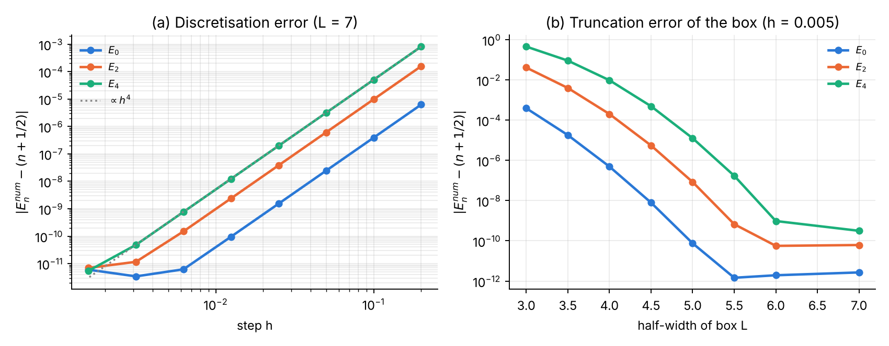{width=100%}

# Part V — Cross-check of the Fortran and Python implementations

All three Fortran programs reproduce the Python tables digit for digit (the only differences are in the last digit of quantities at the round-off level, e.g. $1.2\times10^{-12}$ vs $1.5\times10^{-12}$). The Fortran programs write their data to `.dat` files; `plot_fortran_results.py` draws the following figure from them.

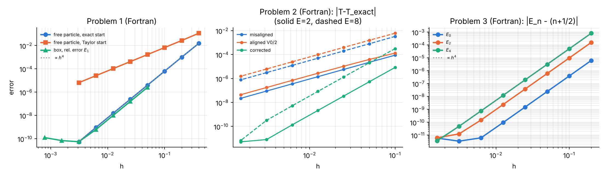{width=100%}

# Part VI — Summary

| | Free particle | Square barrier | Harmonic oscillator |
|---|---|---|---|
| Spectrum | continuous (discrete in a box) | continuous | discrete |
| Numerov use | initial value / shooting to $\psi(L)=0$ | backward complex integration | two-sided shooting + matching |
| Normalisation | Simpson (box); none possible on $\mathbb{R}$ | incident amplitude, flux $R+T=1$ | Simpson |
| Main fault met | starting values | discontinuous $V$ | instability in forbidden region |
| Observed order | 4 (2 with Taylor start) | 2 naive, 4 corrected | 4 |
| Best accuracy reached | $\sim10^{-11}$ | $\sim10^{-12}$ | $\sim10^{-12}$ |

Key messages:

1. Numerov is a cheap fourth-order integrator for $\psi'' = -k^2\psi$; the observed ratio 16 on halving $h$ is the signature of correct implementation.
2. The order is only realised if the starting values are accurate enough, the potential is smooth (or its discontinuities are treated explicitly) and integration never proceeds into a classically forbidden region.
3. Normalisation, orthogonality, the virial theorem and current conservation are necessary checks — but only comparison with exact results or grid refinement measures the *error*.
4. Grid refinement cannot go below the round-off floor; Richardson extrapolation is the cheap way to gain extra digits.

# Part VII — Exercises

1. **Order from two grids** [@Richardson27]. Using the Problem 1 Part A table, compute $p = \log_2[\varepsilon(h)/\varepsilon(h/2)]$ for every pair of rows and explain the last value (17.6).
2. **A better start** [@Blatt67]. In Part A use the third-order Taylor start $\psi_1 = kh - (kh)^3/6$. Predict, then measure, the global order.
3. **Points per wavelength** [@Thijssen]. For the box, find the smallest $N$ that gives $E_{10}$ with relative error $<10^{-6}$. Express the result as points per wavelength and compare with the rule of thumb of Part I.
4. **Dispersion relation** [@Elaydi]. Replace $e^{ikx}$ by $e^{ik_hx}$ (with the discrete $k_h$ of Part I) in the starting values and in the extraction of $A$, $B$ in Problem 2. Does the error decrease? Why?
5. **Thick barrier** [@Merzbacher; @Griffiths, ch. 9]. Compute $T$ for $V_0 = 5$, $a = 6$, $E = 1$. Compare with the WKB estimate $T \approx e^{-2\kappa a}$. What limits the accuracy, and what happens to $R+T$?
6. **Smooth barrier** [@PT33; @LL, §25]. Replace the square barrier by $V(x) = V_0/\cosh^2(x/w)$, whose exact $T$ is known. Show that no correction is needed to obtain fourth order.
7. **One-sided shooting** [@KM, ch. 3]. Modify Problem 3 to integrate from $-L$ to $+L$ and require $\psi_N = 0$. For which $L$ does the bisection still converge to $E_0$? Explain with fault no. 4.
8. **Anharmonic oscillator** [@BW69; @Sakurai, ch. 5]. Use the Problem 3 code for $V = x^2/2 + \lambda x^4$ with $\lambda = 0.1$. Check against first-order perturbation theory $\Delta E_n = \tfrac{3\lambda}{4}(2n^2+2n+1)$ for small $\lambda$.
9. **Finite square well** [@Griffiths, §2.6]. Turn Problem 2 into a bound-state problem with $V = -V_0$ for $|x|<a/2$ using the shooting/matching method of Problem 3 and the discontinuity correction of Problem 2. Verify the even-state condition $q\tan(qa/2) = \kappa$ with $q = \sqrt{2(V_0-|E|)}$, $\kappa = \sqrt{2|E|}$.
10. **Round-off** [@Goldberg91; @IEEE754]. Repeat the $E_0$ study of Problem 3 in single precision (Fortran `real(4)`) and locate the new optimum $h$.

# References

{{BIBLIOGRAPHY}}
