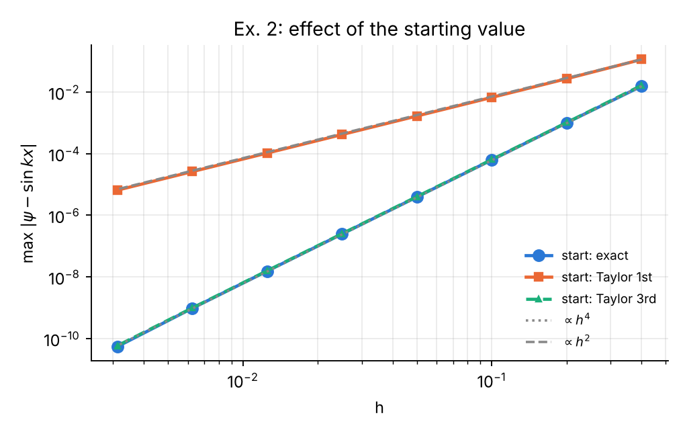
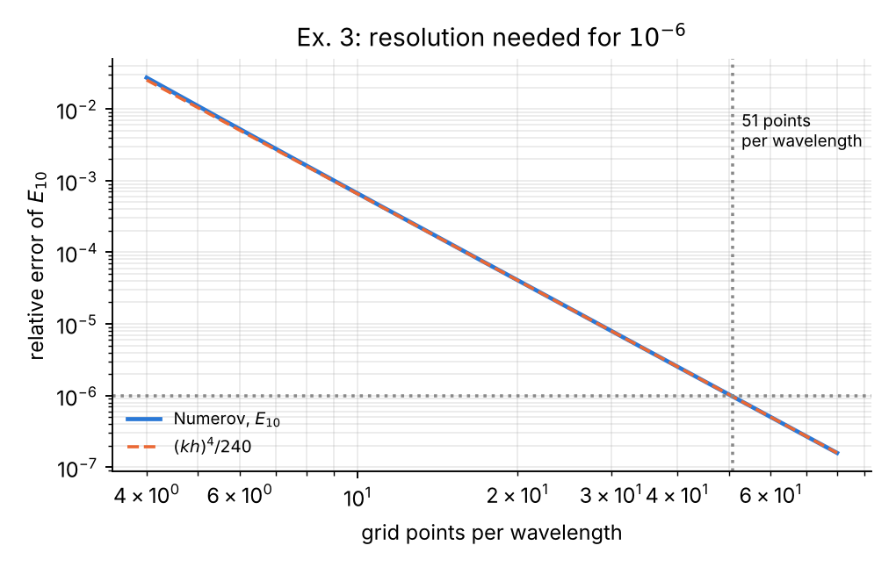
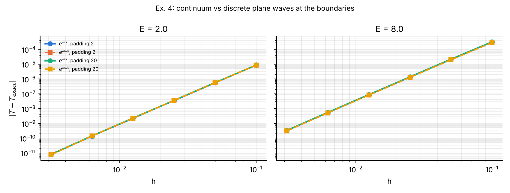
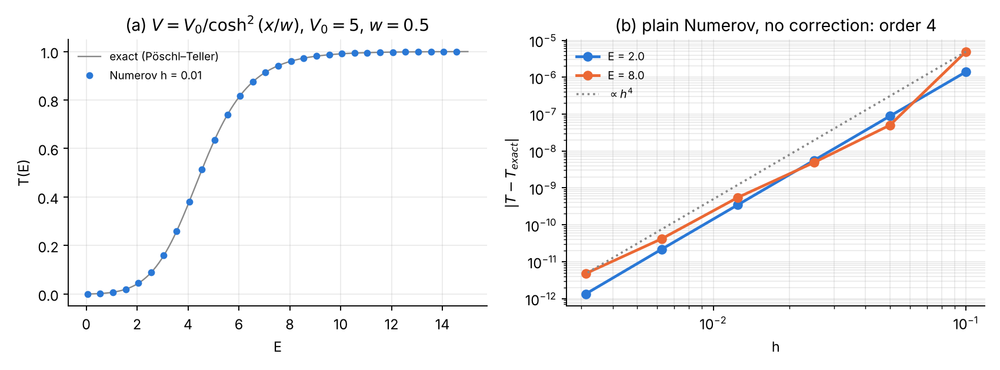
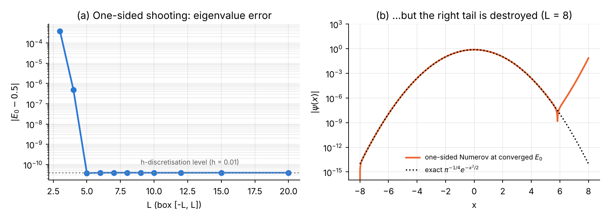
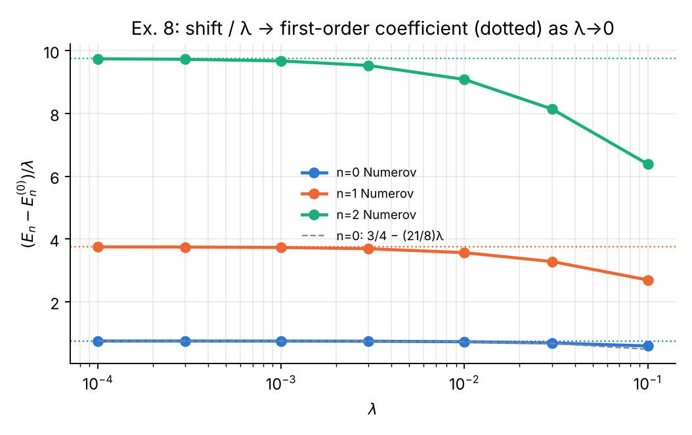
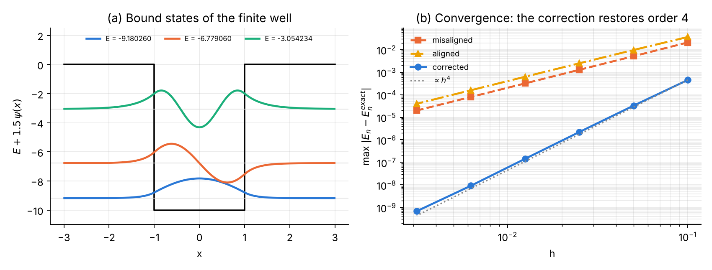
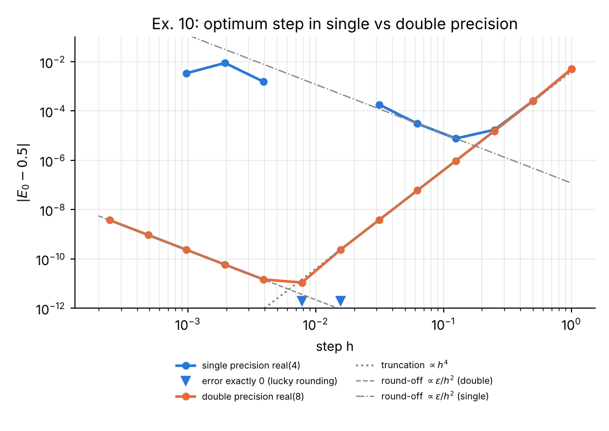

# How the solutions are organised

Each solution follows the same pattern: **(1) the question**, **(2) a prediction** made from the theory of Part I of the course *before* computing, **(3) the method** (what was changed in the course codes), **(4) the results**, and **(5) the answer and its explanation**. Each exercise ends with its own reference list; the complete bibliography is at the end. All numbers were produced by the programs listed in the Appendix (`ex01_05.py`, `ex06_09.py`, `ex10_precision.F90`, `ex10_plot.py`). Units $\hbar = m = 1$ throughout.

| Ex. | Topic | Short answer |
|--|----------|----------------------------------|
| 1 | Order from two grids | $p \approx 4.00$; the 17.6 (p = 4.14) is a round-off artefact |
| 2 | Third-order Taylor start | Start error $O(h^5)$ ⇒ global order 4 restored (measured 4.00) |
| 3 | Points per wavelength | $N_{\min}=254$ ⇒ 51 points per wavelength for $10^{-6}$; error $=(kh)^4/240$ |
| 4 | Discrete plane waves $e^{ik_hx}$ | Error falls by only 0–8 %: the dominant error is in the barrier, and $T$ ignores phases |
| 5 | Thick barrier | $T = 4.6537\times10^{-15}$, WKB too small by the prefactor 2.56; $R+T$ cannot resolve $T$ |
| 6 | Smooth barrier | No correction needed: order 3.99–4.02, accuracy $10^{-12}$ |
| 7 | One-sided shooting | $E_0$ still converges for $5\lesssim L\lesssim 20$, but the tail of $\psi$ is destroyed and $L\gtrsim 27$ overflows |
| 8 | Anharmonic oscillator | $\Delta E_n/\lambda \to \tfrac34(2n^2+2n+1)$ as $\lambda\to0$; at $\lambda=0.1$, $E_0=0.5591463271$ |
| 9 | Finite square well | 3 bound states, exact conditions satisfied; corrected scheme order 3.90, naive order 2 |
| 10 | Single precision | Optimum $h\approx 0.125$, best error $7.6\times10^{-6}$ (double: $h\approx0.008$, $1.1\times10^{-11}$) |

# Exercise 1 — Order from two grids

**Question.** Using the Problem 1, Part A table, compute $p=\log_2[\varepsilon(h)/\varepsilon(h/2)]$ for every pair of rows and explain the last value (17.6).

**Prediction.** For a fourth-order method [@Blatt67; @Richardson27] $\varepsilon(h) \approx C h^4$, so $\varepsilon(h)/\varepsilon(h/2) = 16$ and $p = 4$, as long as round-off is negligible.

**Results** (the table was extended by two more halvings to show what happens next):

| N → 2N | ε(h) | ε(h/2) | ratio | p |
|---|---:|---:|---:|---:|
| 25 → 50 | 1.554e-02 | 1.011e-03 | 15.4 | 3.94 |
| 50 → 100 | 1.011e-03 | 6.285e-05 | 16.1 | 4.01 |
| 100 → 200 | 6.285e-05 | 3.924e-06 | 16.0 | 4.00 |
| 200 → 400 | 3.924e-06 | 2.455e-07 | 16.0 | 4.00 |
| 400 → 800 | 2.455e-07 | 1.533e-08 | 16.0 | 4.00 |
| 800 → 1600 | 1.533e-08 | 9.503e-10 | 16.1 | 4.01 |
| 1600 → 3200 | 9.503e-10 | 5.401e-11 | **17.6** | **4.14** |
| 3200 → 6400 | 5.401e-11 | 2.180e-10 | 0.25 | −2.01 |
| 6400 → 12800 | 2.180e-10 | 1.509e-09 | 0.14 | −2.79 |

**Explanation of 17.6.**

* The first pair gives 3.94 because $h=0.4$ ($kh = 0.8$) is not yet in the asymptotic regime: higher-order terms $h^6, h^8$ still contribute.
* From $N=50$ to $N=1600$ the value is 4.00 ± 0.01 — the theoretical order.
* Extrapolating the clean $h^4$ law from $N=200$ predicts $\varepsilon(N{=}3200) = 5.99\times10^{-11}$; the computed value is $5.40\times10^{-11}$. The measured error is *smaller* than the truncation error because the accumulated round-off error (of size $10^{-11}$ here, with a random sign) happens to partially cancel it. The ratio is therefore artificially large (17.6 instead of 16).
* One more halving confirms the diagnosis: the error *increases* ($p<0$). Below $h\approx 3\times10^{-3}$ the round-off error, which grows roughly like $\epsilon/h^2$ for a second-order recursion [@Higham, ch. 1–2], dominates. A ratio larger than 16 is thus the first warning sign that the round-off floor has been reached; the optimum step for this problem is $h \approx 3\times10^{-3}$.

# Exercise 2 — A better start

**Question.** Use $\psi_1 = kh - (kh)^3/6$. Predict, then measure, the global order.

**Prediction.** The exact value is $\sin kh = kh - (kh)^3/6 + (kh)^5/120 - \dots$, so the start error is $\delta = (kh)^5/120 = O(h^5)$. From Part I, a start error $\delta$ produces a global error $O(\delta/h) = O(h^4)$ [@Blatt67] — the same order as Numerov's own truncation error. **Predicted global order: 4.** (The first-order start $\psi_1=kh$ has $\delta = O(h^3)$ and gives order 2.)

**Results** ($k=2$, $X=10$):

| N | h | error, exact start | error, Taylor 1st | error, Taylor 3rd | ratio (3rd) |
|---:|---:|---:|---:|---:|---:|
| 25 | 0.400 | 1.554e-02 | 1.144e-01 | 1.647e-02 | — |
| 50 | 0.200 | 1.011e-03 | 2.711e-02 | 1.021e-03 | 16.1 |
| 100 | 0.100 | 6.285e-05 | 6.694e-03 | 6.430e-05 | 15.9 |
| 200 | 0.050 | 3.924e-06 | 1.668e-03 | 4.014e-06 | 16.0 |
| 400 | 0.025 | 2.455e-07 | 4.168e-04 | 2.510e-07 | 16.0 |
| 800 | 0.0125 | 1.533e-08 | 1.042e-04 | 1.567e-08 | 16.0 |
| 1600 | 0.00625 | 9.503e-10 | 2.604e-05 | 9.716e-10 | 16.1 |
| 3200 | 0.003125 | 5.401e-11 | 6.510e-06 | 5.770e-11 | 16.8 |

Fitted orders: exact start 3.99, first-order Taylor 2.02, **third-order Taylor 4.00**.

{width=72%}

**Answer.** As predicted, the global order is 4. The third-order start adds only about 2 % to the error (the start contribution $|\varepsilon_3 - \varepsilon_{\text{exact}}|$ is $1.4\times10^{-6}$ at $N=100$ against a total of $6.4\times10^{-5}$). Rule: *the starting value must be accurate to $O(h^5)$*; any Taylor start of order 4 or higher is sufficient.

# Exercise 3 — Points per wavelength

**Question.** For the box ($L=1$), find the smallest $N$ that gives $E_{10}$ with relative error below $10^{-6}$; express it as points per wavelength and compare with the rule of thumb.

**Theory (prediction).** In the box, $\sin(k_h x)$ with the *discrete* wave number $k_h$ satisfies the Numerov recursion exactly and vanishes at $x=0$ and $x=L$ when $k_h = n\pi/L$. Hence the numerical eigenvalue obeys $k_h(E) = n\pi/L$ exactly. Using the dispersion relation of Part I (the exact solution of the constant-coefficient recurrence [@Elaydi, ch. 2]), $k_h = k[1+(kh)^4/480]$, the numerical $k$ is too small by the factor $1-(kh)^4/480$ and, since $E\propto k^2$,

$$
\frac{E_n^{\text{num}} - E_n}{E_n} \approx -\frac{(kh)^4}{240},\qquad kh = \frac{2\pi}{P},
$$

where $P = \lambda/h$ is the number of grid points per wavelength. Setting this equal to $10^{-6}$:

$$
P = \frac{2\pi}{(240\times10^{-6})^{1/4}} = \frac{2\pi}{0.1245} \approx 50.5 .
$$

The numerical energy is always **below** the exact one (as in the table of Problem 1).

**Results.** For $n=10$ the wavelength is $\lambda = 2L/n = 0.2$.

| N | kh | relative error of $E_{10}$ | $(kh)^4/240$ |
|---:|---:|---:|---:|
| 40 | 0.785 | 1.622e-03 | 1.585e-03 |
| 100 | 0.314 | 4.074e-05 | 4.059e-05 |
| 200 | 0.157 | 2.539e-06 | 2.537e-06 |
| 252 | 0.125 | 1.007e-06 | — |
| **254** | **0.124** | **9.757e-07** | 9.751e-07 |

**$N_{\min} = 254$**, i.e. $h = 0.00394$, **50.8 points per wavelength**. The same criterion is independent of $n$, as the theory says:

| n | N_min | points per wavelength |
|---:|---:|---:|
| 1 | 26 | 52.0 |
| 2 | 52 | 52.0 |
| 5 | 128 | 51.2 |
| 10 | 254 | 50.8 |
| 20 | 506 | 50.6 |

{width=72%}

**Comparison with the rule of thumb.** The rule "20–30 points per wavelength" [@Thijssen; @Giannozzi] of Part I gives relative errors of $(2\pi/20)^4/240 = 4.1\times10^{-5}$ to $(2\pi/30)^4/240 = 8.0\times10^{-6}$: it is adequate for 4–5 significant digits. For $10^{-6}$ one needs about **51 points per wavelength**; in general $P \approx 2\pi\,(240\,\varepsilon)^{-1/4}$ for a target relative error $\varepsilon$ — doubling the accuracy demand costs only a factor $2^{1/4} = 1.19$ in grid points, the benefit of a fourth-order method.

# Exercise 4 — Dispersion relation in the scattering problem

**Question.** Replace $e^{ikx}$ by $e^{ik_hx}$ in the starting values and in the extraction of $A, B$ (Problem 2). Does the error decrease? Why?

**Prediction.** In the free regions $V=0$ the *discrete* solutions [@Elaydi, ch. 2] of the Numerov recursion are exactly $e^{\pm ik_hx}$. With $e^{ik_hx}$ the right boundary is an exact transmitted discrete wave and the decomposition on the left is exact, so the free regions contribute *no* error and the result should not depend on the padding length. With $e^{ikx}$ the two starting values contain a tiny admixture of the reflected discrete wave, of relative size $\sim (k_h-k)/k \sim (kh)^4/480$. Two arguments suggest that the gain will be small: (i) $T = 1/|A|^2$ depends only on moduli, so the accumulated phase error $k^5h^4X/480$ cancels; (ii) the $(kh)^4/480$ coefficient is small compared with the error committed inside the barrier.

**Method.** `scatter(..., use_kh=True)` computes $k_h = \arccos\!\big[(1-\tfrac{5}{12}(kh)^2)/(1+\tfrac{1}{12}(kh)^2)\big]/h$ and uses it in both the start and the $2\times2$ extraction. The corrected discontinuity treatment of Problem 2 is used in all runs.

**Results** ($V_0=5$, $a=1$):

| h | E=2, pad 2: $e^{ikx}$ | E=2, pad 2: $e^{ik_hx}$ | E=8, pad 2: $e^{ikx}$ | E=8, pad 2: $e^{ik_hx}$ | E=8, pad 20: $e^{ikx}$ | E=8, pad 20: $e^{ik_hx}$ |
|---:|---:|---:|---:|---:|---:|---:|
| 0.1 | 8.41e-06 | 8.59e-06 | 3.12e-04 | 2.89e-04 | 3.19e-04 | 2.89e-04 |
| 0.05 | 5.40e-07 | 5.52e-07 | 2.10e-05 | 1.98e-05 | 2.16e-05 | 1.98e-05 |
| 0.025 | 3.43e-08 | 3.50e-08 | 1.34e-06 | 1.28e-06 | 1.38e-06 | 1.28e-06 |
| 0.0125 | 2.16e-09 | 2.20e-09 | 8.45e-08 | 8.09e-08 | 8.71e-08 | 8.09e-08 |
| 0.00625 | 1.36e-10 | 1.39e-10 | 5.29e-09 | 5.08e-09 | 5.46e-09 | 5.08e-09 |

{width=100%}

**Answer.** The error changes by only −8 % to +2 %, and the order remains 4. With $e^{ik_hx}$ the result becomes **exactly independent of the padding length** (identical digits for padding 2 and 20), which confirms that the free regions are now treated exactly; with $e^{ikx}$ a 2–10 % padding dependence remains. The error does not decrease substantially because:

1. **$T$ is phase-insensitive.** The dominant consequence of $k\neq k_h$ is a phase error, which cancels in $|A|^2$ and $|B|^2$.
2. **The error lives in the barrier.** The remaining $O(h^4)$ error comes from integrating through the region $0<x<a$, where $\psi$ changes rapidly (evanescent or short-wavelength) and from the edge treatment — the boundary treatment cannot remove it.

The modification is still good practice: it makes the result independent of where the computational box ends.

# Exercise 5 — Thick barrier

**Question.** Compute $T$ for $V_0=5$, $a=6$, $E=1$; compare with the WKB estimate [@Griffiths, ch. 9; @Merzbacher, ch. 7] $T\approx e^{-2\kappa a}$. What limits the accuracy, and what happens to $R+T$?

**Analytical values.** $\kappa = \sqrt{2(V_0-E)} = 2.82843$, $\kappa a = 16.9706$.

| Quantity | Value |
|---|---:|
| Exact $T$ | 4.653679e-15 |
| WKB $e^{-2\kappa a}$ | 1.817843e-15 |
| Thick-barrier limit $\frac{16E(V_0-E)}{V_0^2}e^{-2\kappa a}$ | 4.653679e-15 |
| Ratio exact/WKB | 2.560 |

For $\kappa a \gg 1$, $\sinh^2(\kappa a)\approx e^{2\kappa a}/4$ and the exact formula [@Merzbacher, ch. 6] reduces to $T \approx \frac{16E(V_0-E)}{V_0^2}e^{-2\kappa a}$. The simple WKB exponent captures the **exponential dependence** perfectly but misses the **prefactor** $16E(V_0-E)/V_0^2 = 2.56$, which comes from the abrupt (non-WKB) edges of the barrier. The ratio WKB/exact = 0.391 is the same for every thickness $a \ge 1$ (table below).

**Numerov results** (corrected edge scheme):

| h | T Numerov | relative error | R | R+T−1 |
|---:|---:|---:|---:|---:|
| 0.05 | 4.65345430e-15 | 4.8e-05 | 0.99999999999999079 | −4.6e-15 |
| 0.025 | 4.65366495e-15 | 3.1e-06 | 0.99999999999996469 | −3.1e-14 |
| 0.0125 | 4.65367840e-15 | 2.0e-07 | 0.99999999999993749 | −5.8e-14 |
| 0.00625 | 4.65367925e-15 | 1.2e-08 | 1.00000000000018940 | +1.9e-13 |
| 0.003125 | 4.65367931e-15 | 6.0e-10 | 0.99999999999941325 | −5.8e-13 |

Thickness scan at $h=0.00625$:

| a | T Numerov | T exact | relative error | WKB/exact | R+T−1 |
|---:|---:|---:|---:|---:|---:|
| 1 | 8.9258e-03 | 8.9258e-03 | 6.5e-09 | 0.391 | −3.8e-11 |
| 2 | 3.1243e-05 | 3.1243e-05 | 7.6e-09 | 0.391 | −2.8e-13 |
| 4 | 3.8131e-10 | 3.8131e-10 | 9.9e-09 | 0.391 | −1.4e-15 |
| 6 | 4.6537e-15 | 4.6537e-15 | 1.2e-08 | 0.391 | 1.9e-13 |
| 8 | 5.6796e-20 | 5.6796e-20 | 1.5e-08 | 0.391 | −4.7e-14 |
| 12 | 8.4597e-30 | 8.4597e-30 | 1.9e-08 | 0.391 | −5.0e-13 |

**What limits the accuracy?**

* $T$ itself is obtained with a *relative* accuracy of $10^{-8}$ even when $T\sim10^{-30}$. This works because the **backward** integration goes in the stable direction: going from right to left through the barrier the physical solution *grows* like $e^{\kappa(a-x)}$, so round-off errors are swamped, and $T = 1/|A|^2$ is computed directly from a large number ($|A| = 1.5\times10^{7}$) — never as a small difference.
* The remaining error is the Numerov discretisation error (order 4 in the table), whose relative size grows slowly (linearly) with $a$ because the phase/decay-rate error accumulates over the barrier: $6.5\times10^{-9}$ at $a=1$ to $1.9\times10^{-8}$ at $a=12$.
* The ultimate limit is overflow: $|A|\sim e^{\kappa a}$ exceeds $10^{308}$ when $\kappa a > 709$, i.e. $a \gtrsim 250$ here.

**What happens to $R+T$?** $R = 1 - 4.65\times10^{-15}$ cannot be represented more precisely than about $\pm 10^{-16}$ in double precision, and its round-off error ($10^{-13}$–$10^{-12}$: the relative round-off of $|A|$ and $|B|$, accumulated over thousands of steps) is **larger than $T$ itself**. $R+T-1$ therefore shows only round-off noise and contains no information about $T$. Conclusion: for opaque barriers *never* compute $T$ as $1-R$ and never use $R+T=1$ as an accuracy test; compute $T$ from the transmitted amplitude.

# Exercise 6 — Smooth barrier

**Question.** Replace the square barrier by $V(x) = V_0/\cosh^2(x/w)$, whose exact $T$ is known; show that no correction is needed to obtain fourth order.

**Exact result** (Pöschl–Teller / Eckart barrier [@PT33; @LL, §25]) for $\hbar=m=1$ and $8V_0w^2>1$:

$$
T(E) = \frac{\sinh^2(\pi k w)}{\sinh^2(\pi k w) + \cosh^2\!\left(\frac{\pi}{2}\sqrt{8V_0w^2-1}\right)}, \qquad k=\sqrt{2E},
$$

($\cosh^2 \to \cos^2(\frac{\pi}{2}\sqrt{1-8V_0w^2})$ when $8V_0w^2<1$). Parameters: $V_0=5$, $w=0.5$ ($8V_0w^2 = 10$), computational box $[-12,12]$, where $V(\pm12) = 3\times10^{-20}$ is negligible.

**Prediction.** $V$ is analytic, so $\psi$ and all its derivatives are continuous; the Taylor expansions behind Numerov hold everywhere and the plain scheme should be fourth order with no special treatment.

**Results.** Plain Numerov, no edge nodes, no correction:

| E | T Numerov (h = 0.01) | T exact | \|ΔT\| | R+T−1 |
|---:|---:|---:|---:|---:|
| 1 | 0.0066549324 | 0.0066549324 | 3.6e-12 | 8.2e-13 |
| 3 | 0.1505171785 | 0.1505171781 | 3.7e-10 | 1.8e-13 |
| 5 | 0.6247014391 | 0.6247014405 | 1.4e-09 | 1.8e-13 |
| 8 | 0.9585694821 | 0.9585694818 | 2.5e-10 | 2.6e-13 |

| h | \|ΔT\|, E = 2 | ratio | \|ΔT\|, E = 8 | ratio |
|---:|---:|---:|---:|---:|
| 0.1 | 1.40e-06 | — | 4.95e-06 | — |
| 0.05 | 8.83e-08 | 15.9 | 5.02e-08 | 98.6 |
| 0.025 | 5.54e-09 | 15.9 | 4.85e-09 | 10.4 |
| 0.0125 | 3.47e-10 | 16.0 | 5.49e-10 | 8.8 |
| 0.00625 | 2.18e-11 | 15.9 | 4.17e-11 | 13.2 |
| 0.003125 | 1.33e-12 | 16.4 | 4.74e-12 | 8.8 |
| **order** | **3.99** | | **4.02** | |

{width=100%}

**Answer.** The fitted orders are 3.99 and 4.02: **no correction is needed**. Compare with the square barrier, where the uncorrected scheme was second order. For $E=8$ the individual ratios scatter (98.6, 10.4, …) because the error is a sum of several $h^4$ contributions of different sign that partly cancel at some $h$; the overall slope is still 4. The maximum error over $0<E<15$ at $h=0.01$ is $2.6\times10^{-9}$. Lesson: the loss of order in Problem 2 was caused by the *discontinuity of the potential*, not by the scattering formulation.

# Exercise 7 — One-sided shooting

**Question.** Modify Problem 3 to integrate from $-L$ to $+L$ and require $\psi_N = 0$. For which $L$ does the bisection still converge to $E_0$? Explain with fault no. 4.

**Method.** $\psi_0 = 0$, $\psi_1 = 10^{-10}$, Numerov from $-L$ to $+L$ with $h = 0.01$; bisection on the sign of $F(E)=\psi_N(E)$ in $[0.3, 0.7]$ (100 halvings).

**Results.**

| L | $E_0$ (one-sided) | \|E₀ − 0.5\| | $e^{L^2/2}$ |
|---:|---:|---:|---:|
| 3 | 0.500391082888 | 3.9e-04 | 9.0e+01 |
| 4 | 0.500000490818 | 4.9e-07 | 3.0e+03 |
| 5 | 0.500000000038 | 3.8e-11 | 2.7e+05 |
| 6 | 0.499999999961 | 3.9e-11 | 6.6e+07 |
| 8 | 0.499999999961 | 3.9e-11 | 7.9e+13 |
| 10 | 0.499999999961 | 3.9e-11 | 5.2e+21 |
| 15 | 0.499999999961 | 3.9e-11 | 7.2e+48 |
| 20 | 0.499999999961 | 3.9e-11 | 7.2e+86 |
| 30 | overflow (NaN) | — | — |

{width=100%}

**Answer and explanation** [@KM, ch. 3; @Giannozzi]. Perhaps surprisingly, the **eigenvalue** converges to $E_0$ for all $5 \lesssim L \lesssim 20$ with the same accuracy ($3.9\times10^{-11}$) as the two-sided method. For $L<5$ the error is the box-truncation error (identical to the two-sided result of Problem 3); for $L \gtrsim 27$ the computation overflows. What happens is:

1. Beyond the right turning point the computed solution is $\psi = \alpha(E)\,\phi_{\downarrow} + \beta(E)\,\phi_{\uparrow}$, with $\phi_\uparrow \sim e^{+x^2/2}$. At $x=L$ the growing part dominates completely, so $\operatorname{sign}\psi_N = \operatorname{sign}\beta(E)$. $\beta(E)$ changes sign exactly at the discrete eigenvalue, and round-off adds to $\beta$ a contribution equivalent to an energy shift of order $\epsilon\approx10^{-16}$. Bisection on the *sign* is therefore insensitive to the instability: the eigenvalue survives.
2. The **wavefunction does not survive** (fault no. 4). Even at the converged energy, the residual $\beta$ (from the finite bisection resolution and round-off) is amplified by $e^{x^2/2}$. Panel (b) shows that for $L=8$ the computed $\psi$ follows the exact Gaussian only up to $x \approx 6$ and then grows to $|\psi(L)|\approx 0.07$ — a value $10^{12}$ times larger than the exact $\psi(8)\approx 10^{-14}$. Such a function cannot be normalised reliably, and expectation values ($\langle x^2\rangle$, the virial check) are wrong.
3. **Overflow.** The growing solution reaches $\sim10^{-10}e^{L^2}$ at $x=+L$; this exceeds the largest double ($1.8\times10^{308}$ [@IEEE754]) when $L^2 \gtrsim 732$, i.e. $L\gtrsim 27$ (NaN at $L=30$).

So one-sided shooting gives correct energies for moderate $L$ but wrong wavefunctions and fails for large boxes; the two-sided method of Problem 3 avoids both problems by never integrating into a forbidden region.

# Exercise 8 — Anharmonic oscillator

**Question.** Use the Problem 3 code for $V = x^2/2 + \lambda x^4$, $\lambda = 0.1$; check against first-order perturbation theory $\Delta E_n = \frac{3\lambda}{4}(2n^2+2n+1)$ for small $\lambda$.

**First-order perturbation theory** [@Sakurai, §5.1; @Griffiths, ch. 7]. With $x = (a+a^\dagger)/\sqrt2$, $\langle n|x^4|n\rangle = \frac{3}{4}(2n^2+2n+1)$, hence $\Delta E_n^{(1)} = \frac{3\lambda}{4}(2n^2+2n+1)$: coefficients 0.75, 3.75, 9.75 for $n=0,1,2$. For the ground state the series continues $E_0 = \frac12 + \frac34\lambda - \frac{21}{8}\lambda^2 + \frac{333}{16}\lambda^3 - \dots$ (an asymptotic, divergent series [@BW69]).

**Method.** The Problem 3 module is imported unchanged and only its potential is replaced (`P3.V = lambda x: 0.5*x*x + lam*x**4`); box $[-6,6]$, $h=0.01$. As an **independent check**, the Hamiltonian is also diagonalised in a basis of 160 harmonic-oscillator states (`ho_basis_energies`).

**Results.**

| λ | n | E Numerov | E basis | (E − E⁽⁰⁾)/λ | 1st-order coef. |
|---:|---:|---:|---:|---:|---:|
| 1e-4 | 0 | 0.500074973732 | 0.500074973771 | 0.749737 | 0.75 |
| 1e-4 | 1 | 1.500374793721 | 1.500374793994 | 3.747937 | 3.75 |
| 1e-4 | 2 | 2.500974231527 | 2.500974232502 | 9.742315 | 9.75 |
| 1e-3 | 0 | 0.500747395535 | 0.500747395575 | 0.747396 | 0.75 |
| 1e-3 | 1 | 1.503729615426 | 1.503729615703 | 3.729615 | 3.75 |
| 1e-3 | 2 | 2.509674351733 | 2.509674352726 | 9.674352 | 9.75 |
| 1e-2 | 0 | 0.507256204483 | 0.507256204525 | 0.725620 | 0.75 |
| 1e-2 | 1 | 1.535648277992 | 1.535648278297 | 3.564828 | 3.75 |
| 1e-2 | 2 | 2.590845795041 | 2.590845796191 | 9.084580 | 9.75 |
| **0.1** | 0 | **0.559146327122** | 0.559146327184 | 0.591463 | 0.75 |
| **0.1** | 1 | **1.769502643379** | 1.769502643950 | 2.695026 | 3.75 |
| **0.1** | 2 | **3.138624305981** | 3.138624308498 | 6.386243 | 9.75 |

{width=72%}

**Answer.**

* **Small λ.** $(E_n - E_n^{(0)})/\lambda$ tends to 0.75, 3.75, 9.75 as $\lambda\to0$ (at $\lambda=10^{-4}$: 0.7497, 3.7479, 9.7423). The deviation is linear in $\lambda$, as expected from the second-order term: for $n=0$, $\frac34 - \frac{21}{8}(10^{-3}) = 0.747375$, and adding the third-order term $\frac{333}{16}(10^{-3})^2$ gives 0.747396 — exactly the computed value.
* **λ = 0.1.** $E_0 = 0.5591463271$, in agreement with the basis diagonalisation to $6\times10^{-11}$ (the Numerov discretisation error at $h=0.01$). First-order perturbation theory gives 0.575 (+2.8 %); for $n=2$ it gives 3.475 instead of 3.1386 (+11 %), because the higher states extend to larger $|x|$ where $\lambda x^4$ is no longer small. Adding more terms does not help much (second order 0.54875, third order 0.56956): the perturbation series is asymptotic.
* **Practical remarks.** The Problem 3 code works unchanged because the turning-point estimate $\sqrt{2E}$ lies slightly outside the true turning point, which only places the matching node a little inside the forbidden region — harmless. A smaller box ($L=6$) is sufficient because the quartic term makes the wavefunctions decay faster.

# Exercise 9 — Finite square well

**Question.** Turn Problem 2 into a bound-state problem with $V=-V_0$ for $|x|<a/2$, using the shooting/matching method of Problem 3 and the discontinuity correction of Problem 2; verify the even-state condition $q\tan(qa/2)=\kappa$.

**Analytical scheme** [@Griffiths, §2.6; @Messiah, ch. III]. With $E<0$, $q=\sqrt{2(V_0-|E|)}$ inside and $\kappa=\sqrt{2|E|}$ outside, matching $\psi'/\psi$ at $x=a/2$ gives

$$
\text{even: } q\tan\frac{qa}{2} = \kappa, \qquad \text{odd: } -q\cot\frac{qa}{2} = \kappa .
$$

With $V_0 = 10$, $a = 2$: $\sqrt{2V_0}\,a/2 = 4.47$, so there are $\lceil 4.47/(\pi/2)\rceil = 3$ bound states (even, odd, even). They were found with a root finder (`brentq`) to $10^{-15}$.

**Numerical scheme.**

* Grid $[-8,8]$; the well edges $x=\pm1$ are grid nodes with $V=-V_0/2$.
* Outward Numerov from $-8$ and inward from $+8$, matched at the **centre** $x=0$ with the discrete Wronskian $D(E)$ of Problem 3. (The centre is inside the allowed region, and both integrations start in forbidden regions — the stable direction.)
* The edge correction of Problem 2 is applied in both directions: one-sided $V$ in stencils neighbouring an edge, and at an edge node the term $\delta=-\frac{h^3}{12}[k^2]\psi'$, with $\psi'$ from the side already integrated: $(3\psi_e-4\psi_{e-1}+\psi_{e-2})/2h$ outward, $(-3\psi_e+4\psi_{e+1}-\psi_{e+2})/2h$ inward.
* Odd states have $\psi(0)=0$, so the two pieces are glued with the ratio at node $m+1$ instead of $m$.

**Results** ($h=0.01$, corrected):

| state | E exact | E Numerov | \|ΔE\| | exact condition: lhs = κ | parity error |
|---|---:|---:|---:|---|---:|
| even (n=0) | −9.180259926233 | −9.180259901486 | 2.5e-08 | 4.2849177183 = 4.2849177183 | 2.5e-14 |
| odd (n=1) | −6.779060021410 | −6.779059962042 | 5.9e-08 | 3.6821352559 = 3.6821352559 | 6.4e-10 |
| even (n=2) | −3.054233508774 | −3.054233501211 | 7.6e-09 | 2.4715313103 = 2.4715313103 | 1.2e-13 |

The exact energies satisfy the transcendental conditions to all printed digits; inserting the *numerical* energies leaves residuals of $3.7\times10^{-7}$, $2.3\times10^{-7}$ and $1.5\times10^{-8}$ — consistent with $|\Delta E|$. The numerical wavefunctions have the correct parity ($\psi(-x) = \pm\psi(x)$).

**Convergence** (largest $|\Delta E|$ among the three states):

| h | misaligned | aligned $V_0/2$ | corrected |
|---:|---:|---:|---:|
| 0.1 | 2.09e-02 | 3.64e-02 | 4.51e-04 |
| 0.05 | 5.12e-03 | 9.66e-03 | 3.28e-05 |
| 0.025 | 1.28e-03 | 2.48e-03 | 2.21e-06 |
| 0.0125 | 3.18e-04 | 6.28e-04 | 1.44e-07 |
| 0.00625 | 7.96e-05 | 1.58e-04 | 9.15e-09 |
| 0.003125 | 1.99e-05 | 3.97e-05 | 6.80e-10 |
| **order** | **2.01** | **1.96** | **3.90** |

{width=100%}

**Answer.** The method works and the exact even/odd conditions are verified. The behaviour seen for the barrier repeats exactly for the well: without the correction the energies converge only as $h^2$, with the correction as $h^4$ (at $h=0.003$ the corrected scheme is 30 000–60 000 times more accurate).

# Exercise 10 — Round-off in single precision

**Question.** Repeat the $E_0$ study of Problem 3 in single precision (Fortran `real(4)`) and locate the new optimum $h$.

**Theory (prediction)** [@Higham, ch. 1–2; @Goldberg91]. Total error $\approx A h^4 + B\epsilon/h^2$. Minimising, $h_{\text{opt}} = (B\epsilon/2A)^{1/6} \propto \epsilon^{1/6}$ and $\varepsilon_{\min} \propto \epsilon^{2/3}$. With the IEEE 754 [@IEEE754] unit round-offs $\epsilon_{\text{single}}/\epsilon_{\text{double}} = 1.19\times10^{-7}/2.22\times10^{-16} = 5.4\times10^{8}$:

* $h_{\text{opt}}$ should grow by $(5.4\times10^8)^{1/6} = 28.5$;
* $\varepsilon_{\min}$ should grow by $(5.4\times10^8)^{2/3} = 6.6\times10^5$.

**Method.** One Fortran source (`ex10_precision.F90`) with the working kind `wp` set by the preprocessor [@MRC], compiled twice: `-DWP=4` (single) and `-DWP=8` (double). Two-sided Numerov, discrete-Wronskian matching, bisection carried down to machine precision, box $[-6,6]$.

**Results.**

| N | h | \|E₀−0.5\| single | \|E₀−0.5\| double |
|---:|---:|---:|---:|
| 12 | 1.0 | 4.96e-03 | 4.96e-03 |
| 24 | 0.5 | 2.52e-04 | 2.53e-04 |
| 48 | 0.25 | 1.72e-05 | 1.54e-05 |
| **96** | **0.125** | **7.63e-06** | 9.56e-07 |
| 192 | 0.0625 | 3.05e-05 | 5.96e-08 |
| 384 | 0.03125 | 1.83e-04 | 3.73e-09 |
| 768 | 0.015625 | 0 (lucky) | 2.32e-10 |
| 1536 | 0.0078125 | 0 (lucky) | **1.09e-11** |
| 3072 | 0.0039 | 1.53e-03 | 1.46e-11 |
| 6144 | 0.0020 | 8.85e-03 | 5.82e-11 |
| 12288 | 0.00098 | 3.39e-03 | 2.33e-10 |
| 24576 | 0.00049 | fails (no sign change) | 9.31e-10 |
| 49152 | 0.00024 | fails | 3.73e-09 |

{width=72%}

**Answer.**

* **Single precision:** optimum $h \approx 0.125$ ($N=96$, i.e. 8 points per unit length), best error $7.6\times10^{-6}$. Below $h\approx0.004$ the matching function is pure noise and the bisection no longer even finds a sign change.
* **Double precision:** optimum $h\approx 0.008$, best error $1.1\times10^{-11}$; to the left of the optimum the error grows by a factor 4 per halving of $h$ — exactly the $\epsilon/h^2$ law.
* **Comparison with the prediction:** the measured ratio of optimal steps is $0.125/0.0078 = 16$ (predicted 28.5 — on a grid of factor-2 steps this is within one step), and the ratio of minimum errors is $7.6\times10^{-6}/1.1\times10^{-11} = 7\times10^5$ (predicted $6.6\times10^5$). The $\epsilon^{2/3}$ law is confirmed remarkably well.
* The two runs coincide for $h \ge 0.5$: there the truncation error dominates and precision is irrelevant.
* The two "exact" single-precision results ($E_0 = 0.5$ exactly at $N=768, 1536$) are accidents of rounding to the nearest representable float and must not be mistaken for convergence — a good reason to always look at the *trend* of the error, not individual values.

**Practical lesson.** In single precision Numerov cannot deliver more than about 5 significant digits, whatever the grid; refining beyond $h\approx0.1$ makes the result *worse*. Scientific Numerov codes should always use double precision, and Richardson extrapolation from two moderately fine grids is preferable to brute-force refinement.

# References

{{BIBLIOGRAPHY}}

# Appendix — Codes

All programs are in the accompanying zip archive. Run with

```bash
python3 ex01_05.py          # exercises 1-5   (needs numpy, matplotlib)
python3 ex06_09.py          # exercises 6-9   (needs scipy; imports ../python/p3_harmonic_oscillator.py)
python3 ex06_09.py 7 9      # only selected exercises
gfortran -O2 -cpp -DWP=4 -o ex10_sp ex10_precision.F90 && ./ex10_sp
gfortran -O2 -cpp -DWP=8 -o ex10_dp ex10_precision.F90 && ./ex10_dp
python3 ex10_plot.py        # plots the two .dat files
```

## Exercises 1–5 (Python)

{{CODE:python:../../exercises/ex01_05.py}}

## Exercises 6–9 (Python)

{{CODE:python:../../exercises/ex06_09.py}}

## Exercise 10 (Fortran 90, single and double precision)

{{CODE:fortran:../../exercises/ex10_precision.F90}}

## Exercise 10 — plotting script

{{CODE:python:../../exercises/ex10_plot.py}}
