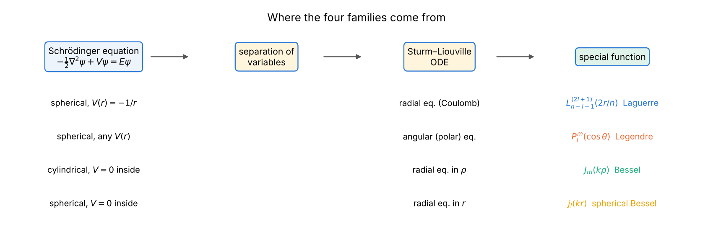
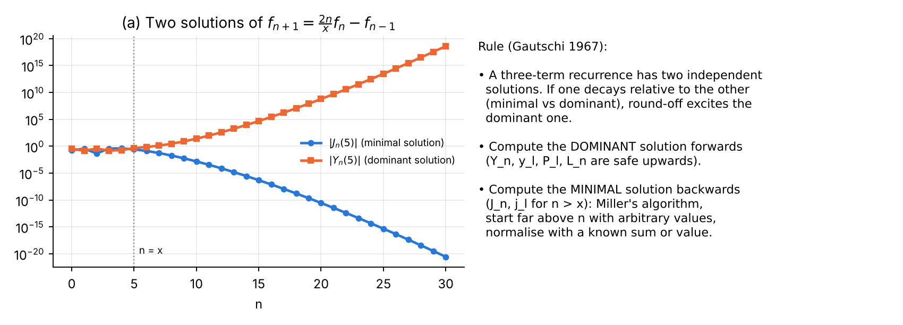
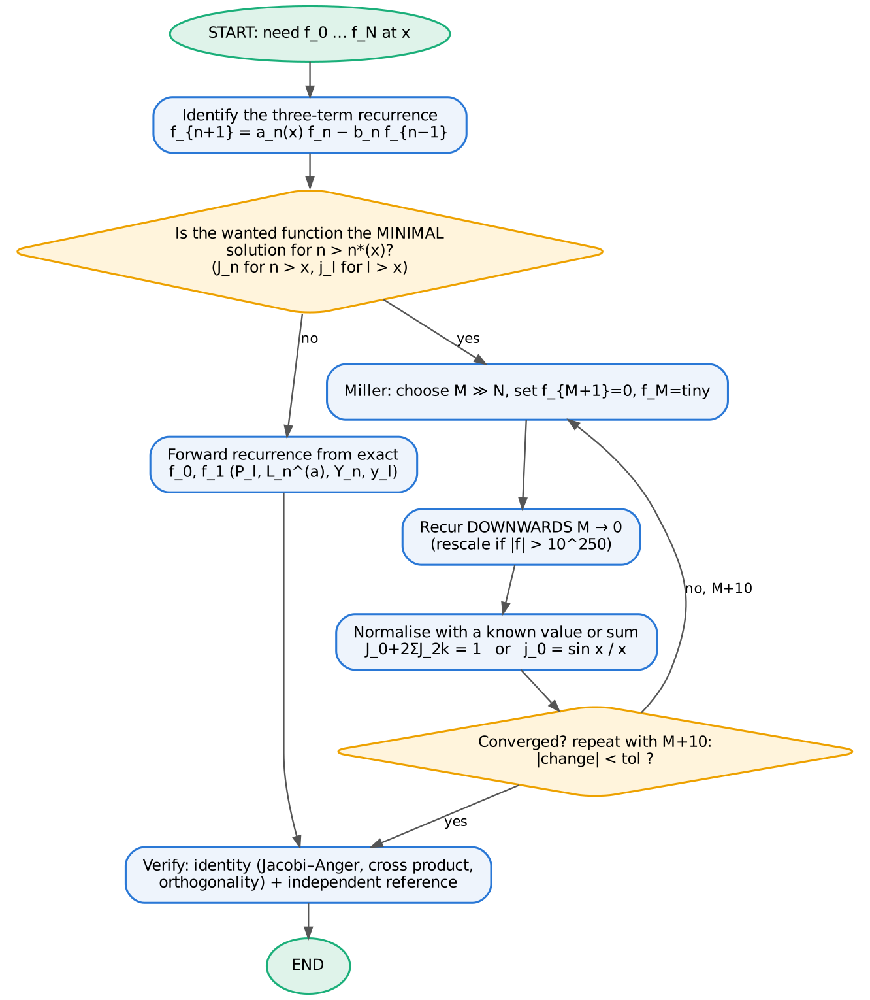
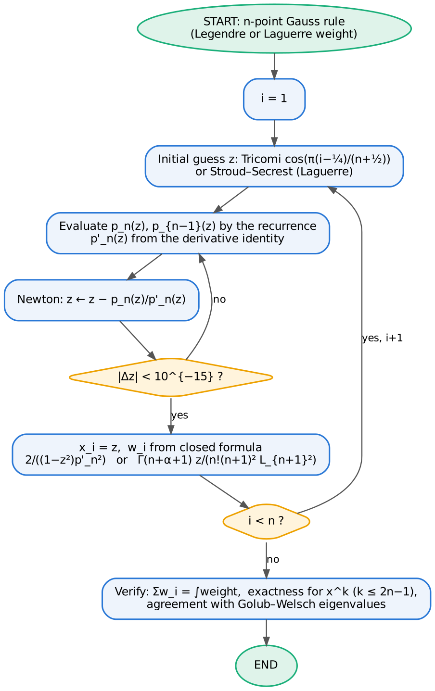

# How to use this course

This course is the sequel to *The Numerov Method for the One-Dimensional Schrödinger Equation* [@Course1]. It treats the four families of special functions that a physicist meets first when the Schrödinger equation is separated in three dimensions:

| Chapter | Special function | Where it appears | Schrödinger problem solved with Numerov |
|---|---|---|---|
| 1 | Generalised Laguerre polynomials $L_n^{(\alpha)}$ | radial Coulomb problem | hydrogen atom |
| 2 | Legendre polynomials and associated functions $P_l^m$ | polar-angle equation | rigid rotor / angular equation |
| 3 | Cylindrical Bessel functions $J_m$ | radial equation in polar coordinates | particle in a circular (cylindrical) well |
| 4 | Spherical Bessel functions $j_l$ | radial equation for $V=0$ | particle in a spherical well |

Every chapter has the same structure, which mirrors the first course:

1. **The function**: definition, differential equation, the main formulas, with numbered citations to the NIST *Digital Library of Mathematical Functions* (DLMF) [@DLMF] and to standard textbooks; each chapter ends with its own reference list, and the complete bibliography is at the end of the document.
2. **The physics**: how the function arises from the Schrödinger equation, and the exact solution.
3. **Analytical scheme**: the formulas the program uses, written *before* the code — Part A (computing the function itself) and Part B (solving the Schrödinger equation with Numerov).
4. **Logic charts.**
5. **Codes**: a Python 3 program and a Fortran 2008 program implementing the same algorithms. They agree to all printed digits.
6. **Results, normalisation and verification.**
7. **Error analysis and convergence plots.**
8. **Worked examples and exercises with answers.**

Units: $\hbar = m = 1$ throughout (and atomic units, $e = 4\pi\varepsilon_0 = 1$, for hydrogen).

**Software.** Python 3 with NumPy [@NumPy], SciPy [@SciPy], Matplotlib and mpmath [@mpmath] (used only as a 50-digit *reference*, never inside the algorithms), SymPy [@SymPy] for symbolic checks; gfortran (Fortran 2008 [@F2008; @MRC] is needed for the intrinsics `log_gamma`, `gamma` and `bessel_jn`).

```bash
python3 ch1_laguerre_hydrogen.py        # likewise ch2_..., ch3_..., ch4_...
gfortran -O2 -o ch1 ch1_laguerre_hydrogen.f90 && ./ch1    # likewise ch2 ... ch4
python3 plot_fortran_results.py         # plots the .dat files written by the Fortran codes
```

# Part 0 — Common foundations

## What a "special function" is

Special functions are functions that have established names and notations because of their importance in analysis, physics and engineering; the term is defined by consensus rather than formally. In the narrow sense used here they are the *special functions of mathematical physics*: solutions of the ordinary differential equations obtained when a partial differential equation (Laplace, Helmholtz, Schrödinger, wave, heat) is solved by separation of variables [@EoM; @DLMF, Ch. 10, 14, 18; @Lebedev]. The standard modern reference is the DLMF [@DLMF], the online version of the *NIST Handbook of Mathematical Functions* [@NISTHB], which continues Abramowitz & Stegun [@AS].

{width=100%}

## Sturm–Liouville structure

All four ordinary differential equations are of Sturm–Liouville form

$$
-\big(p(x)\,y'\big)' + q(x)\,y = \lambda\,w(x)\,y ,
$$

with a positive weight $w$. On an interval with suitable boundary conditions the eigenfunctions are **orthogonal** with weight $w$, the eigenvalues are real and simple, and the $n$-th eigenfunction has $n$ nodes (Sturm oscillation theorem) [@CH, ch. V–VI; @Arfken, ch. 8]. Orthogonality is therefore a built-in verification tool for every numerical solution in this course.

| Family | $p(x)$ | $w(x)$ | interval | singular points |
|---|---|---|---|---|
| Laguerre $L_n^{(\alpha)}$ | $x^{\alpha+1}e^{-x}$ | $x^\alpha e^{-x}$ | $[0,\infty)$ | regular at 0, irregular at $\infty$ |
| Legendre $P_l^m$ | $1-x^2$ | 1 | $[-1,1]$ | regular at $\pm1$ |
| Bessel $J_m(kr)$ | $r$ | $r$ | $[0,a]$ | regular at 0 |
| spherical Bessel $j_l(kr)$ | $r^2$ | $r^2$ | $[0,a]$ | regular at 0 |

## Liouville normal form — the bridge to Numerov

Numerov's method [@Numerov24; @Course1, Part I] integrates equations of the form $u'' = -k^2(x)\,u$ without a first-derivative term. A Sturm–Liouville equation is brought to this form by a change of the dependent variable; in all our cases it is a multiplication by a power of the coordinate [@CH, ch. V; @BO]:

| Equation | Substitution | Normal form |
|---|---|---|
| hydrogen, radial | $u = rR$ | $u'' = \big[\tfrac{l(l+1)}{r^2} - \tfrac{2}{r} - 2E\big]u$ |
| polar angle | $u = \sqrt{\sin\theta}\,\Theta$ | $u'' = -\big[\lambda + \tfrac14 + \tfrac{1/4-m^2}{\sin^2\theta}\big]u$ |
| cylindrical radial | $u = \sqrt{r}\,R$ | $u'' = -\big[2E - \tfrac{m^2-1/4}{r^2}\big]u$ |
| spherical radial | $u = rR$ | $u'' = -\big[2E - \tfrac{l(l+1)}{r^2}\big]u$ |

The two "square-root" transformations were verified symbolically (SymPy [@SymPy] residual = 0). They are exact, but they have a hidden cost discussed below: they make the solution **non-analytic** at the singular point.

## Three-term recurrences and their stability

Every family in this course satisfies a three-term recurrence in its index [@DLMF, §10.6, §14.10, §18.9], for example

$$
J_{n+1}(x) = \frac{2n}{x}J_n(x) - J_{n-1}(x),\qquad (l+1)P_{l+1} = (2l+1)xP_l - lP_{l-1}.
$$

Recurrences are the fastest and usually the most accurate way to compute special functions — *provided they are run in the right direction*. A second-order difference equation has two independent solutions $f_n$, $g_n$. If $f_n/g_n \to 0$ as $n\to\infty$, $f$ is called **minimal** and $g$ **dominant**. Round-off errors excite the dominant solution, so [@Gautschi67; @DLMF, §3.6; @GST, ch. 4]:

* a **dominant** solution can be computed **forwards** (Legendre $P_l$, Laguerre $L_n$, $Y_n$, $y_l$);
* a **minimal** solution must be computed **backwards**. $J_n(x)$ and $j_l(x)$ are minimal once $n > x$. **Miller's algorithm** [@Miller52; error analysis @Olver64] starts far above the wanted index with arbitrary values, recurs downwards (the wanted solution grows in that direction), and fixes the scale with a known value or sum.

{width=100%}

{width=55%}

## Gaussian quadrature

The zeros of orthogonal polynomials are the nodes of Gaussian quadrature: an $n$-point rule $\int w(x)f(x)\,dx \approx \sum_i w_i f(x_i)$ is exact for polynomials of degree $\le 2n-1$ [@DLMF, §3.5(v); @SS66]. Nodes are found either by Newton's method on $p_n$ with good initial guesses, or as eigenvalues of the symmetric tridiagonal Jacobi matrix built from the recurrence coefficients [@GW69]. We use Newton (in both languages) and Golub–Welsch (Python) as an independent check. Gauss rules converge **exponentially** for analytic integrands [@Trefethen08] — a property we use both as a verification and as an example of error analysis.

{width=45%}

## Numerov near a regular singular point: the Frobenius start and the start fault

Near $r=0$ the solutions of the normal-form equations behave like $r^{s}$, where $s$ solves the indicial equation of the Frobenius method [@BO, ch. 3; @Arfken, §7.5]:

| Problem | regular solution | irregular solution | $u$ analytic at 0? |
|---|---|---|---|
| hydrogen / spherical well | $r^{l+1}$ | $r^{-l}$ | **yes** |
| circular well (index $m$) | $r^{m+1/2}$ | $r^{-m+1/2}$ (or $r^{1/2}\ln r$ for $m=0$) | **no** |
| polar angle (index $m$) | $\theta^{m+1/2}$ | $\theta^{-m+1/2}$ (log for $m=0$) | **no** |

**Frobenius start.** Inserting $u = r^{s}\sum_k a_k r^k$ into the equation gives a recurrence for the $a_k$; with 25–40 terms the series is accurate to machine precision for small $r$. The series values provide the starting values that Numerov needs (fault no. 2 of the first course [@Course1]).

**The start fault.** A useful way to understand what goes wrong near $r=0$ is the following argument. Suppose that near $r\approx h$ the computation makes a *relative* error $\delta$. Such a local error adds a small multiple of the **irregular** solution to the computed one, with amplitude

$$
\alpha \;\sim\; \delta\;\frac{u_{\text{reg}}(h)}{u_{\text{irr}}(h)} \;=\; \delta\, h^{\,s_{\text{reg}}-s_{\text{irr}}} ,
$$

and the error in the eigenvalue is proportional to $\alpha$. Two mechanisms produce an $h$-independent $\delta$:

1. **Non-analytic solution, start at the first grid nodes.** For $u\propto r^{m+1/2}$, the Numerov stencil centred at node $j$ has a relative defect that depends on $j$ but **not on $h$** (figure below, panel b), because $u^{(6)}\propto r^{m-11/2}$. Hence $\delta=O(1)$ and the eigenvalue error is $O(h^{2m})$: **no convergence for $m=0$, second order for $m=1$, fourth order only for $m\ge 2$.**
2. **Analytic solution, "naive" textbook start** $u_0 = 0,\ u_1 = h^{l+1}$ with $c_0u_0$ taken as $0$. The correct value of $c_0u_0 = \lim_{r\to0}\big(u + \tfrac{h^2}{12}k^2u\big)$ is *not* zero when $k^2u$ has a finite limit at $r=0$ — this happens for the Coulomb term with $l=0$ and for the centrifugal term with $l=1$. The resulting defect gives order $h^{2}$ (hydrogen s states) and $h^{3}$ (p states).

**The cure** is simple: evaluate the Frobenius series on $[0, r_s]$ for a *fixed* $r_s$ (independent of $h$; we use $r_s = 1/8$, $\theta_s = 0.4$ or $r_s = 0.25$) and start Numerov from there. The solution is then smooth on the Numerov interval and fourth order is restored in every case. This "start fault and its cure" is the central numerical lesson of this course; each chapter demonstrates it.

{width=100%}

## Verification and error-analysis toolkit

Each program applies the following checks, which the student should regard as compulsory for any numerical work on special functions:

| Check | What it tests |
|---|---|
| comparison with a 50-digit reference (mpmath [@mpmath]) | absolute accuracy of the function values |
| independent identity (Jacobi–Anger, cross product, $\sum w_i$, closed forms) | correctness without any reference software |
| comparison with SciPy [@SciPy] / Fortran intrinsic `bessel_jn` [@F2008] | independent implementation |
| normalisation $\int u^2 = 1$ (Simpson) | eigenfunction scale; Simpson has $O(h^4)$ error, consistent with Numerov |
| comparison with the exact eigenfunction built from Part A | shape of the numerical solution |
| orthogonality, parity, node count | Sturm–Liouville structure |
| expectation values ($\langle r\rangle$, $\langle r^2\rangle$, $\langle\cos^2\theta\rangle$, virial theorem) | physics content of the wavefunction |
| observed order $p$ from a sequence of grids | correct implementation of a 4th-order method |
| Richardson extrapolation $E_R = (16E_{h/2}-E_h)/15$ [@Richardson27] | consistency of the $h^4$ error model |
| round-off floor, box-size truncation | limits of attainable accuracy |
