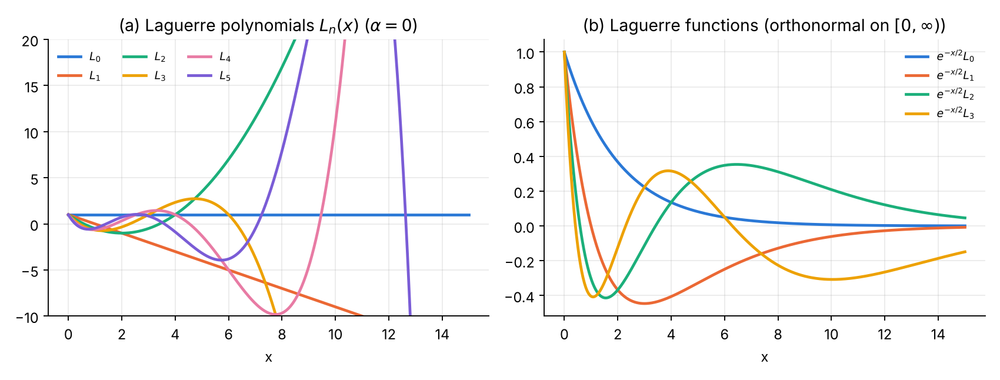
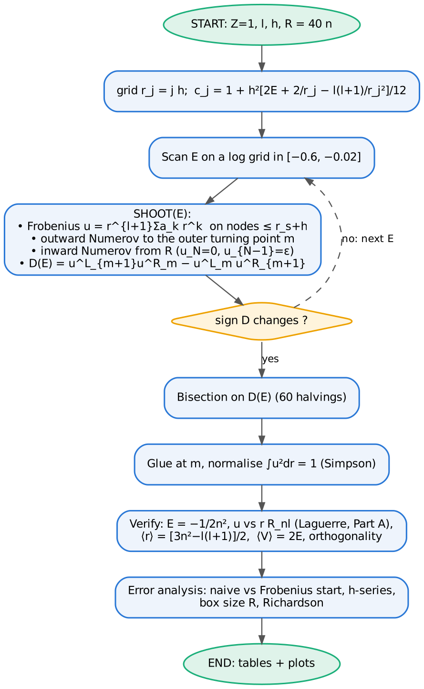
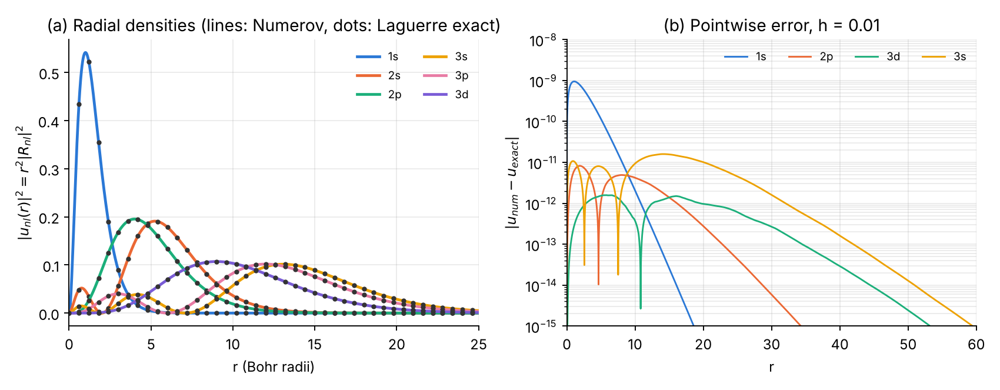
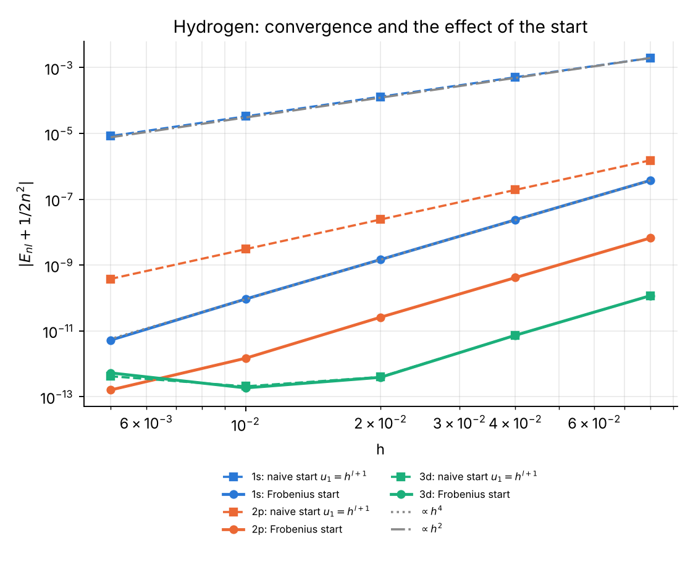

# Chapter 1 — Laguerre polynomials and the hydrogen atom

## 1.1 The function

The **generalised (associated) Laguerre polynomials** $L_n^{(\alpha)}(x)$, $\alpha>-1$, are the polynomial solutions of

$$
x\,y'' + (\alpha + 1 - x)\,y' + n\,y = 0
$$

(Laguerre differential equation, [@DLMF, §18.8].)

Main properties [@DLMF, §18.3, §18.5, §18.9; @Szego, ch. 5; @Arfken, §18.3; @AS, ch. 22]:

* Rodrigues formula: $L_n^{(\alpha)}(x) = \dfrac{x^{-\alpha}e^{x}}{n!}\dfrac{d^n}{dx^n}\big(e^{-x}x^{n+\alpha}\big)$.
* Explicit sum: $L_n^{(\alpha)}(x) = \displaystyle\sum_{k=0}^{n} (-1)^k\binom{n+\alpha}{n-k}\frac{x^k}{k!}$.
* Orthogonality on $[0,\infty)$: $\displaystyle\int_0^\infty x^\alpha e^{-x} L_m^{(\alpha)}L_n^{(\alpha)}\,dx = \frac{\Gamma(n+\alpha+1)}{n!}\,\delta_{mn}$.
* Three-term recurrence: $(n+1)L_{n+1}^{(\alpha)} = (2n+1+\alpha-x)L_n^{(\alpha)} - (n+\alpha)L_{n-1}^{(\alpha)}$, $L_0=1$, $L_1 = 1+\alpha-x$.
* Derivative: $x\,\dfrac{d}{dx}L_n^{(\alpha)} = nL_n^{(\alpha)} - (n+\alpha)L_{n-1}^{(\alpha)}$.
* Generating function: $\sum_n L_n^{(\alpha)}(x)t^n = (1-t)^{-\alpha-1}e^{-xt/(1-t)}$.
* Zeros: $n$ real simple zeros in $(0, 4n+2\alpha+2)$; they are the nodes of Gauss–Laguerre quadrature.

{width=100%}

## 1.2 The physics: hydrogen atom

For $V = -Z/r$ the separation $\psi = R_{nl}(r)Y_{lm}(\theta,\phi)$, $u = rR$, gives

$$
u'' = \left[\frac{l(l+1)}{r^2} - \frac{2Z}{r} - 2E\right]u, \qquad u(0)=0,\ u(\infty)=0 .
$$

Writing $u = \rho^{l+1}e^{-\rho/2}f(\rho)$, $\rho = 2Zr/n$, turns this into the Laguerre equation with $\alpha = 2l+1$; normalisability forces $f$ to be a polynomial, which quantises the energy [@BS, §1–3; @LL, §36; @Griffiths, §4.2; @DLMF, §18.39]:

$$
E_n = -\frac{Z^2}{2n^2},\qquad
R_{nl}(r) = \sqrt{\left(\frac{2Z}{n}\right)^3\frac{(n-l-1)!}{2n\,(n+l)!}}\;e^{-\rho/2}\rho^{l}\,L_{n-l-1}^{(2l+1)}(\rho),\quad n = l+1, l+2, \dots
$$

Exact expectation values used for verification [@BS, §3]: $\langle r\rangle = \tfrac{1}{2Z}[3n^2 - l(l+1)]$, $\langle r^2\rangle = \tfrac{n^2}{2Z^2}[5n^2+1-3l(l+1)]$, $\langle 1/r\rangle = Z/n^2$, virial theorem $\langle V\rangle = 2E$.

## 1.3 Analytical scheme

**Part A — computing $L_n^{(\alpha)}$.**

1. *Recurrence* (stable: $L_n$ is a dominant solution [@Gautschi67; @GST, ch. 4]) from $L_0, L_1$.
2. *Explicit sum* — for comparison only: its terms alternate in sign and grow like $x^k/k!$, so for large $x$ the sum suffers catastrophic cancellation.
3. *Gauss–Laguerre nodes*: Newton iteration $z\leftarrow z - L_n/L_n'$ with the Stroud–Secrest initial guesses [@SS66; @NR, §4.6]; weights $w_i = \dfrac{\Gamma(n+\alpha+1)\,x_i}{n!\,(n+1)^2\,[L_{n+1}^{(\alpha)}(x_i)]^2}$. Check: Golub–Welsch [@GW69] eigenvalues of the Jacobi matrix with diagonal $2k+1+\alpha$ and off-diagonal $-\sqrt{k(k+\alpha)}$.

**Part B — Numerov for hydrogen.**

* Grid $r_j = jh$, $j = 0..N$, box $R = 40n$ (the tail is $\propto r^n e^{-r/n}$).
* $k_j^2 = 2E + 2/r_j - l(l+1)/r_j^2$, $c_j = 1 + h^2k_j^2/12$.
* **Frobenius start**: $u = r^{l+1}\sum_k a_kr^k$ with $a_0=1$, $a_1 = -2/(2l+2)$,
  $$k(k+2l+1)\,a_k = -2a_{k-1} - 2E\,a_{k-2},$$
  evaluated on all nodes $r_j \le r_s + h$, $r_s = 0.25$. For comparison: the **naive start** $u_0=0$, $u_1=h^{l+1}$.
* **Two-sided shooting** (as for the oscillator of the first course [@Course1; @KM, ch. 3]): outward Numerov up to the node $m$ nearest the *outer* classical turning point $r_t = \big[1+\sqrt{1+2El(l+1)}\big]/(-2E)$; inward Numerov from $R$ with $u_N=0$, $u_{N-1}=10^{-30}$.
* Matching function: discrete Wronskian $D(E) = u^L_{m+1}u^R_m - u^L_mu^R_{m+1}$; scan $E$ on a logarithmic grid, refine by bisection (60 halvings).
* Normalise with Simpson; compare with $rR_{nl}$ built from the **Part A recurrence** (so Part A is verified by Part B and vice versa).

## 1.4 Logic chart

{width=58%}

## 1.5 Python 3 code

{{CODE:python:../python/ch1_laguerre_hydrogen.py}}

## 1.6 Fortran 2008 code

{{CODE:fortran:../fortran/ch1_laguerre_hydrogen.f90}}

## 1.7 Results, normalisation and verification

**Part A.** $L_{30}^{(1)}(x)$ against a 50-digit reference (mpmath [@mpmath]):

| x | recurrence | rel. error recurrence | rel. error explicit sum |
|---:|---:|---:|---:|
| 0.5 | 2.163585262160450 | 1.2e-15 | 1.9e-12 |
| 5 | −4.516468178217739 | 5.9e-16 | 2.7e-07 |
| 20 | −1624.339169078655 | 1.4e-16 | 6.9e-02 |
| 60 | 4.650827778222133e+11 | 2.6e-16 | 2.3e-01 |

Further checks: the 20-point Gauss–Laguerre nodes from Newton and from Golub–Welsch agree to $3.6\times10^{-14}$, $\sum w_i = 1$ to $10^{-14}$; orthogonality of $L_0^{(2)}\dots L_{12}^{(2)}$ with a 40-point rule holds to $2.8\times10^{-14}$; agreement with SciPy [@SciPy] `eval_genlaguerre` to $1.4\times10^{-14}$. A 20-point rule integrates $x^{39}e^{-x}$ exactly ($4\times10^{-16}$) but not $x^{40}e^{-x}$ ($7\times10^{-12}$), as the theory of Gaussian quadrature predicts [@DLMF, §3.5(v)].

**Part B.** Hydrogen, $h = 0.01$, Frobenius start:

| n | l | E Numerov | E exact | \|ΔE\| | ∫u²dr | max\|u − u_ex\| | ⟨r⟩ | ⟨r⟩ exact | ⟨V⟩/2E |
|---:|---:|---:|---:|---:|---:|---:|---:|---:|---:|
| 1 | 0 | −0.500000000093 | −0.5 | 9.3e-11 | 1.000000000000 | 9.4e-10 | 1.50000 | 1.5 | 1.0000000 |
| 2 | 0 | −0.125000000001 | −0.125 | 1.4e-12 | 1.000000000000 | 7.1e-11 | 6.00000 | 6 | 1.0000000 |
| 2 | 1 | −0.124999999999 | −0.125 | 1.5e-12 | 1.000000000000 | 8.2e-12 | 5.00000 | 5 | 1.0000000 |
| 3 | 0 | −0.055555555556 | −1/18 | 1.9e-13 | 1.000000000000 | 1.6e-11 | 13.50000 | 13.5 | 1.0000000 |
| 3 | 1 | −0.055555555555 | −1/18 | 5.2e-13 | 1.000000000000 | 8.3e-12 | 12.50000 | 12.5 | 1.0000000 |
| 3 | 2 | −0.055555555556 | −1/18 | 1.8e-13 | 1.000000000000 | 1.6e-12 | 10.50000 | 10.5 | 1.0000000 |
| 4 | 3 | −0.031250000000 | −1/32 | 1.0e-13 | 1.000000000000 | 3.1e-12 | 18.00000 | 18 | 1.0000000 |

The energy scan finds, for each $l$, exactly the levels $n = l+1, l+2,\dots$ — the **$l$-degeneracy** of the Coulomb problem [@LL, §36] is reproduced. States of equal $l$ are orthogonal (below $10^{-9}$), and the virial theorem holds to 7 digits.

{width=100%}

## 1.8 Error analysis and convergence

![(a) $L_{30}^{(1)}$: the explicit sum loses all accuracy for $x\gtrsim 15$, the recurrence stays at round-off level. (b) Gauss–Laguerre quadrature: exponential convergence for the entire function $\cos x$, slower for $1/(1+x)$ (pole at $x=-1$), and only algebraic ($\propto n^{-1.5}$) for $\sqrt x$, whose derivative is singular at the end point [@Trefethen08].](../python/ch1_partA_errors.png){width=100%}

**Discretisation error and the start (Part B).**

| h | 1s naive | 1s Frobenius | 2p naive | 2p Frobenius | 3d naive | 3d Frobenius |
|---:|---:|---:|---:|---:|---:|---:|
| 0.08 | 1.96e-03 | 3.73e-07 | 1.52e-06 | 6.63e-09 | 1.17e-10 | 1.17e-10 |
| 0.04 | 5.11e-04 | 2.37e-08 | 1.92e-07 | 4.15e-10 | 7.34e-12 | 7.34e-12 |
| 0.02 | 1.31e-04 | 1.47e-09 | 2.42e-08 | 2.59e-11 | 3.97e-13 | 3.87e-13 |
| 0.01 | 3.30e-05 | 9.25e-11 | 3.03e-09 | 1.47e-12 | 2.06e-13 | 1.85e-13 |
| 0.005 | 8.29e-06 | 5.23e-12 | 3.80e-10 | 1.60e-13 | 4.17e-13 | 5.28e-13 |
| **order** | **1.97** | **4.02** | **2.99** | **4.00** | 3.99 | 3.99 |

{width=72%}

Interpretation (Part 0): $u$ is analytic, so the stencil itself is fine; but the naive start sets $c_0u_0 = 0$ although $\lim_{r\to0}k^2u = 2Zu'(0)\neq 0$ for $l=0$ and $=-l(l+1)\,u''(0)/2 \ne 0$ for $l=1$. The resulting defect excites the irregular solution with relative amplitude $h^{2l+1}\times\delta$, giving order 2 for s states and 3 for p states. For $l\ge2$ the limit vanishes and the naive start is harmless. With the Frobenius start the order is 4 for all $l$, until the round-off floor ($\sim2\times10^{-13}$) is reached.

**Richardson extrapolation** [@Richardson27] (2p): $E(0.04) = -0.124999999585$, $E(0.02) = -0.124999999974$, $E_R = -0.125000000000$ (error $8\times10^{-15}$).

**Box truncation** ($3s$, $h=0.01$): replacing $u(\infty)=0$ by $u(R)=0$ gives $|\Delta E| = 9.6\times10^{-4}$ ($R=25$), $1.3\times10^{-6}$ ($R=40$), $3.3\times10^{-11}$ ($R=60$), $2\times10^{-13}$ ($R\ge80$). The decay is $\propto R^{2n}e^{-2R/n}$, which motivates the choice $R = 40n$.

## 1.9 Exercises

1. **Exactness of Gauss–Laguerre** [@SS66; @DLMF, §3.5(v)]. Show that an $n$-point rule integrates $x^ke^{-x}$ exactly for $k\le 2n-1$. Verify numerically for $n=20$. *Answer:* relative error $4\times10^{-16}$ for $k=39$ and $7\times10^{-12}$ for $k=40$.
2. **Cancellation in the explicit sum** [@GST, ch. 2]. Estimate the largest term of the explicit sum of $L_{30}^{(1)}(x)$ and explain why the relative error at $x=60$ is of order $10^{-1}$. *Hint:* the largest term is $\approx x^k/k!\cdot\binom{31}{30-k}$ near $k\approx x$; compare with $|L_{30}^{(1)}(60)|\approx 4.7\times10^{11}$ and machine precision.
3. **$\langle r^2\rangle$** [@BS, §3]. Compute $\langle r^2\rangle$ for the $3d$ state with the program and compare with $\frac{n^2}{2}[5n^2+1-3l(l+1)]$. *Answer:* 125.999999999 vs 126.
4. **Hydrogen-like ions** [@BS; @Griffiths, §4.2]. Generalise the code to nuclear charge $Z$ (change $2/r\to 2Z/r$ in $k^2$, in the Frobenius recurrence and in $R_{nl}$). Verify $E_n = -Z^2/2n^2$ for He$^+$ ($Z=2$), and explain why the box can be taken $Z$ times smaller.
5. **Screened Coulomb (Yukawa) potential** $V = -e^{-r/D}/r$, $D = 10$ [@Rogers70]. There is no closed form. Use the Coulomb Frobenius series with $E\to E + 1/D$ (why?) and compute the ground state for $h = 0.02$ and $0.01$, then extrapolate. *Answer:* $E(0.02) = -0.40706410$, $E(0.01) = -0.40705880$, Richardson $E_0 = -0.4070585$ (compare: $-0.5$ unscreened; first-order perturbation $-0.5 + 1/D = -0.4$; high-precision tabulations of this potential are given in [@Rogers70]).
6. **Naive start, theory** [@BO, ch. 3]. Show that $\lim_{r\to0}(k^2u)$ equals $2Z$ for $l=0$ (with $u'(0)=1$) and $-2a$ for $l=1$ with $u = ar^2+\dots$, and use the argument of Part 0 to predict orders 2 and 3.
