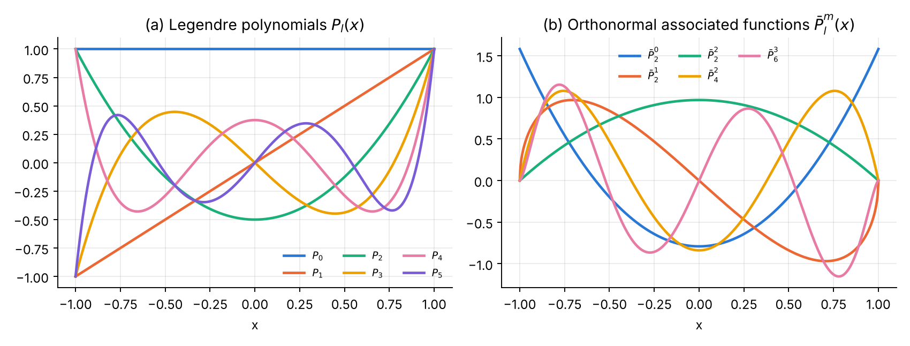
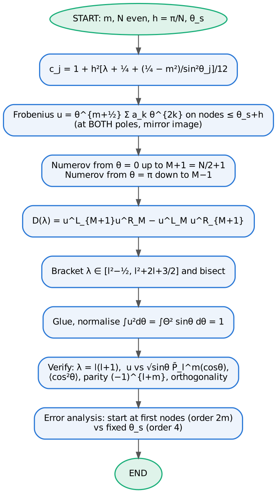
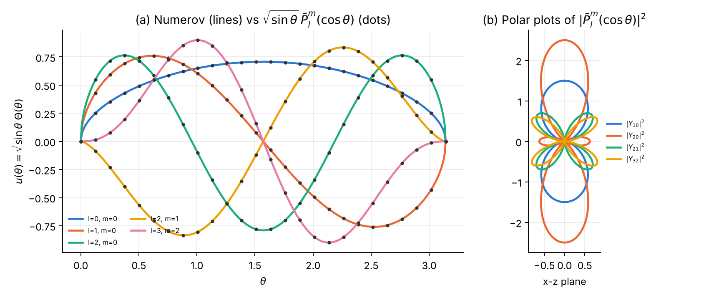
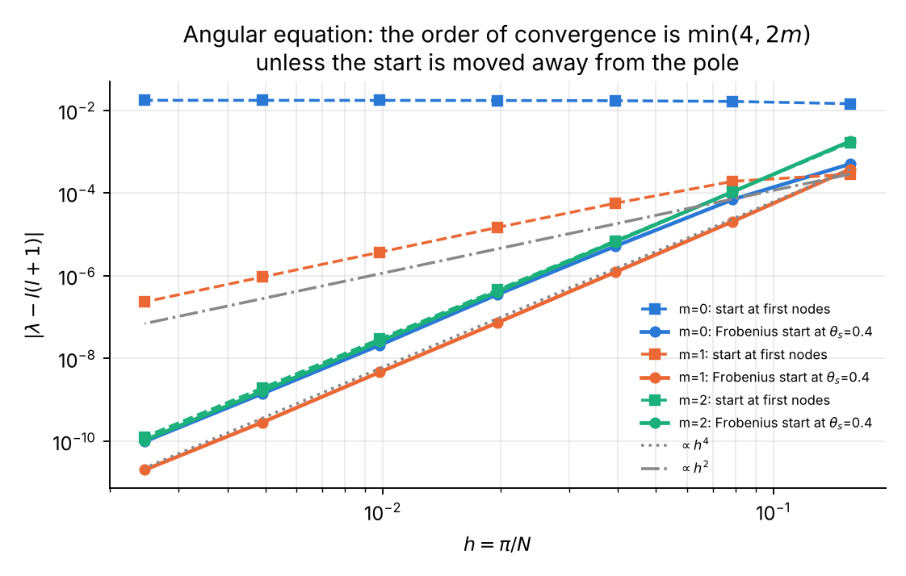

# Chapter 2 — Legendre functions and the angular Schrödinger equation

## 2.1 The function

The **associated Legendre equation** [@DLMF, §14.2]

$$
(1-x^2)\,y'' - 2x\,y' + \left[l(l+1) - \frac{m^2}{1-x^2}\right]y = 0
$$

has, for integer $0\le m\le l$, the solution bounded on $[-1,1]$

$$
P_l^m(x) = (-1)^m(1-x^2)^{m/2}\frac{d^m}{dx^m}P_l(x),\qquad
P_l(x) = \frac{1}{2^l l!}\frac{d^l}{dx^l}(x^2-1)^l \;\;\text{(Rodrigues)}
$$

(the factor $(-1)^m$ is the Condon–Shortley phase, used by the DLMF [@DLMF, §14.7], mpmath [@mpmath] and SciPy [@SciPy]). Main properties [@DLMF, §14.7, §14.10, §14.17, §18.3, §18.9; @Arfken, ch. 15; @Lebedev, ch. 7; @AS, ch. 8]:

* Bonnet recurrence: $(l+1)P_{l+1} = (2l+1)xP_l - lP_{l-1}$, and $P_l'(x) = l\,[xP_l - P_{l-1}]/(x^2-1)$.
* Orthogonality: $\displaystyle\int_{-1}^{1}P_l^mP_{l'}^m\,dx = \frac{2}{2l+1}\frac{(l+m)!}{(l-m)!}\,\delta_{ll'}$.
* Explicit sum: $P_l(x) = 2^{-l}\sum_{k}(-1)^k\binom{l}{k}\binom{2l-2k}{l}x^{l-2k}$.
* Generating function: $(1-2xt+t^2)^{-1/2} = \sum_l P_l(x)t^l$.
* Spherical harmonics: $Y_{lm}(\theta,\phi) = \bar P_l^m(\cos\theta)\,e^{im\phi}/\sqrt{2\pi}$ with the orthonormal functions $\bar P_l^m = \sqrt{\tfrac{2l+1}{2}\tfrac{(l-m)!}{(l+m)!}}\,P_l^m$ [@DLMF, §14.30].

**Overflow-free normalised recurrence** (used in both codes) [@GST, ch. 4; @NR, §6.8]: with $s = \sqrt{1-x^2}$,

$$
\bar P_0^0 = \tfrac{1}{\sqrt2},\quad
\bar P_m^m = -\sqrt{\tfrac{2m+1}{2m}}\,s\,\bar P_{m-1}^{m-1},\quad
\bar P_{m+1}^m = \sqrt{2m+3}\,x\,\bar P_m^m,\quad
\bar P_l^m = a_l\Big(x\bar P_{l-1}^m - \frac{\bar P_{l-2}^m}{a_{l-1}}\Big),\ a_l = \sqrt{\frac{4l^2-1}{l^2-m^2}} .
$$

No factorials appear, so arbitrarily large $l, m$ can be handled (the textbook form starts with $(2m-1)!!$, which overflows for $m\gtrsim150$).

{width=100%}

## 2.2 The physics: the angular equation

For any central potential, $\psi = R(r)\Theta(\theta)e^{im\phi}$ and the polar part satisfies

$$
-\frac{1}{\sin\theta}\frac{d}{d\theta}\Big(\sin\theta\frac{d\Theta}{d\theta}\Big) + \frac{m^2}{\sin^2\theta}\Theta = \lambda\,\Theta ,
$$

i.e. the eigenvalue problem of $\hat L^2$. Regularity at both poles quantises $\lambda = l(l+1)$, $l = |m|, |m|+1,\dots$, with $\Theta = \bar P_l^m(\cos\theta)$ [@Messiah, App. B; @Sakurai, §3.6]. The same equation is the Schrödinger equation of the **rigid rotor** (diatomic molecule) with $E = \lambda/2I$ [@TS; @Zare]. Exact checks (from the recurrence for $xP_l^m$ [@DLMF, §14.10; @Zare]): $\langle\cos^2\theta\rangle = \dfrac{2l(l+1)-2m^2-1}{(2l-1)(2l+3)}$, parity $\Theta(\pi-\theta) = (-1)^{l+m}\Theta(\theta)$.

## 2.3 Analytical scheme

**Part A.** Bonnet recurrence (stable forwards); explicit sum for comparison; normalised recurrence for $\bar P_l^m$; Gauss–Legendre nodes by Newton [@NR, §4.6] from Tricomi's guesses [@GST, ch. 7] $\cos\big(\pi(i-\tfrac14)/(n+\tfrac12)\big)$, weights $w_i = 2/[(1-x_i^2)P_n'(x_i)^2]$.

**Part B.** Liouville transform $u = \sqrt{\sin\theta}\,\Theta$:

$$
u'' + \Big[\lambda + \tfrac14 + \frac{\tfrac14 - m^2}{\sin^2\theta}\Big]u = 0,\qquad u\sim\theta^{m+1/2}\ (\theta\to0),\qquad \int_0^\pi u^2\,d\theta = \int_0^\pi\Theta^2\sin\theta\,d\theta .
$$

* Grid $\theta_j = j\pi/N$, $N$ even; $c_j = 1+h^2k_j^2/12$.
* Frobenius series $u = \theta^{m+1/2}\sum_k a_k\theta^{2k}$ with $1/\sin^2\theta = \sum_j b_j\theta^{2j-2}$ ($b = 1, \tfrac13, \tfrac1{15}, \tfrac2{189}, \tfrac1{675}, \dots$):
  $$2k(2k+2m)\,a_k = -(\lambda+\tfrac14)\,a_{k-1} - (\tfrac14-m^2)\sum_{j\ge1}b_ja_{k-j}.$$
* Two-sided shooting from **both poles** (the problem is symmetric), matched at $\theta = \pi/2$ with the discrete Wronskian $D(\lambda)$; bracket $[l^2-\tfrac12,\ l^2+2l+\tfrac32]$, 64 bisections.
* Start either at the first two nodes or at fixed $\theta_s = 0.4$.

## 2.4 Logic chart

{width=50%}

## 2.5 Python 3 code

{{CODE:python:../python/ch2_legendre_rotor.py}}

## 2.6 Fortran 2008 code

{{CODE:fortran:../fortran/ch2_legendre_rotor.f90}}

## 2.7 Results, normalisation and verification

**Part A.**

| l | x | Bonnet recurrence | rel. error recurrence | rel. error explicit sum |
|---:|---:|---:|---:|---:|
| 10 | 0.30 | 0.2514763495160157 | 2.2e-16 | 4.4e-16 |
| 40 | 0.30 | 0.1251158458557079 | 2.2e-16 | 3.0e-12 |
| 60 | 0.05 | −0.1019617243819477 | 0 | 8.2e-16 |
| 100 | 0.90 | 0.1022658205587189 | 4.1e-16 | 6.7e+17 |

For $l=100$, $x=0.9$ the explicit sum returns a number of order $10^{17}$ instead of $0.10$. The normalised recurrence gives $\bar P_{200}^{180}(0.5) = 0.07231608361615147$ (relative error $1.1\times10^{-14}$) where the unnormalised one overflows. Orthonormality of $\bar P_3^3\dots\bar P_{20}^3$ with a 30-point rule: $7\times10^{-16}$; agreement with SciPy [@SciPy] `lpmv`: $4\times10^{-15}$.

**Part B** ($N = 400$, $\theta_s = 0.4$). A scan of $D(\lambda)$ for $m=1$ finds sign changes near 2.02, 5.97, 11.98, 19.98, 29.98, 41.98 — exactly $l(l+1)$ for $l = 1\dots6$ and no spurious root.

| l | m | λ Numerov | l(l+1) | \|Δλ\| | ∫u²dθ | max\|u − u_ex\| | ⟨cos²θ⟩ | exact |
|---:|---:|---:|---:|---:|---:|---:|---:|---:|
| 0 | 0 | −0.000000002115 | 0 | 2.1e-09 | 1.000000000000 | 7.8e-09 | 0.3333333 | 0.3333333 |
| 1 | 0 | 1.999999994594 | 2 | 5.4e-09 | 1.000000000000 | 1.4e-08 | 0.6000000 | 0.6000000 |
| 2 | 0 | 5.999999991221 | 6 | 8.8e-09 | 1.000000000000 | 1.7e-08 | 0.5238095 | 0.5238095 |
| 1 | 1 | 2.000000000168 | 2 | 1.7e-10 | 1.000000000000 | 1.2e-10 | 0.2000000 | 0.2000000 |
| 2 | 1 | 5.999999998116 | 6 | 1.9e-09 | 1.000000000000 | 4.5e-10 | 0.4285714 | 0.4285714 |
| 3 | 1 | 11.999999979338 | 12 | 2.1e-08 | 1.000000000000 | 1.2e-09 | 0.4666667 | 0.4666667 |
| 2 | 2 | 5.999999999185 | 6 | 8.1e-10 | 1.000000000000 | 5.6e-11 | 0.1428571 | 0.1428571 |
| 3 | 2 | 11.999999989533 | 12 | 1.0e-08 | 1.000000000000 | 4.0e-10 | 0.3333333 | 0.3333333 |
| 5 | 3 | 29.999999892684 | 30 | 1.1e-07 | 1.000000000000 | 4.7e-09 | 0.3504273 | 0.3504274 |

Orthogonality for $m=1$: $7\times10^{-10}$; parity $(-1)^{l+m}$ satisfied to $8\times10^{-12}$.

{width=100%}

## 2.8 Error analysis and convergence

![(a) $P_{40}(x)$: the explicit sum loses accuracy away from $x=0$, the Bonnet recurrence does not. (b) Gauss–Legendre converges exponentially for $e^x$ (machine precision with 8 nodes) and for the Runge function $1/(1+25x^2)$ (more slowly, because of the poles at $\pm i/5$), algebraically for $|x|^3$; the trapezoid rule converges only as $n^{-2}$ [@Trefethen08].](../python/ch2_partA_errors.png){width=100%}

| N | h | m=0 first nodes | m=0 θ_s=0.4 | m=1 first nodes | m=1 θ_s=0.4 | m=2 first nodes | m=2 θ_s=0.4 |
|---:|---:|---:|---:|---:|---:|---:|---:|
| 20 | 0.157 | 1.44e-02 | 5.01e-04 | 2.84e-04 | 3.74e-04 | 1.65e-03 | 1.78e-03 |
| 40 | 0.0785 | 1.63e-02 | 6.88e-05 | 1.90e-04 | 2.03e-05 | 1.06e-04 | 1.06e-04 |
| 80 | 0.0393 | 1.70e-02 | 5.10e-06 | 5.60e-05 | 1.21e-06 | 6.93e-06 | 6.56e-06 |
| 160 | 0.0196 | 1.72e-02 | 3.49e-07 | 1.46e-05 | 7.30e-08 | 4.53e-07 | 4.09e-07 |
| 320 | 0.00982 | 1.73e-02 | 2.08e-08 | 3.69e-06 | 4.64e-09 | 2.95e-08 | 2.56e-08 |
| 640 | 0.00491 | 1.73e-02 | 1.40e-09 | 9.26e-07 | 2.83e-10 | 1.92e-09 | 1.59e-09 |
| 1280 | 0.00245 | 1.74e-02 | 9.75e-11 | 2.32e-07 | 2.00e-11 | 1.26e-10 | 1.04e-10 |
| **order** | | **0.0** | **3.9** | **1.9** | **4.0** | **3.9** | **4.0** |

{width=72%}

This table is the clearest illustration of the start fault of Part 0: for $m=0$ the error is $1.7\times10^{-2}$ *whatever the step* — a calculation that looks perfectly converged in $h$ and is wrong in the second digit. Only a comparison with the exact result or a change of start strategy reveals it.

## 2.9 Exercises

1. **Gauss–Legendre exactness** [@SS66; @DLMF, §3.5(v)]. Show that the $n$-point rule is exact for degree $2n-1$; verify that the 30-point rule integrates $x^{58}$ exactly. *Answer:* error $3.5\times10^{-17}$.
2. **Addition theorem** [@DLMF, §14.30; @Arfken, ch. 16]. Verify numerically $\sum_{m=-l}^{l}|Y_{lm}(\theta,\phi)|^2 = (2l+1)/4\pi$ for $l=5$, $\theta=0.7$ using `plm_bar`. *Answer:* $0.8753521870054248$ vs $0.8753521870054244$.
3. **Why does the Runge function converge slowly?** [@Trefethen08] Relate the convergence rate of Gauss–Legendre for $1/(1+25x^2)$ to the Bernstein ellipse through the poles $\pm i/5$, and estimate the rate $\rho^{-2n}$ with $\rho = 0.2+\sqrt{1.04} = 1.2198$. *Answer:* $\rho^{-80} = 1.3\times10^{-7}$, in agreement with the computed error $1.3\times10^{-7}$ at $n=40$.
4. **Rotor in an electric field (Stark effect / hindered rotor)** [@TS; @Zare]. Add $\beta\cos\theta$ to the angular Hamiltonian ($m=0$): $u'' + [\lambda + \tfrac14 + \tfrac{1}{4\sin^2\theta} - \beta\cos\theta]u = 0$. (a) Show that second-order perturbation theory gives $\lambda_0 \approx -\beta^2/6$. (b) Compute $\lambda_0$ for $\beta = 0.1$ and $1$. (c) **Trap:** the Frobenius series must now include the expansion of $\cos\theta$ about each pole (different signs at the two poles); a series that ignores it gives a wrong answer that converges perfectly in $h$. *Answer:* $\lambda_0 = -0.0016656495$ ($\beta=0.1$; perturbation theory $-0.0016667$), $\lambda_0 = -0.157663483$ ($\beta = 1$), confirmed by diagonalising the Hamiltonian in the basis $\bar P_l^0$, $l<40$, where $\langle l|\cos\theta|l+1\rangle = (l+1)/\sqrt{(2l+1)(2l+3)}$.
5. **The $m=0$ fault, theory** [@BO, ch. 3]. Show that for $m=0$ the irregular solution behaves as $\theta^{1/2}\ln\theta$ and explain why the eigenvalue error does not tend to zero: the ratio of regular to irregular solution at $\theta\approx h$ is $1/|\ln h|$ instead of a positive power of $h$, and the contamination amplitude also involves the $h$-independent defect $\delta$. The table shows that the error in fact settles at a constant, $\approx1.7\times10^{-2}$.
