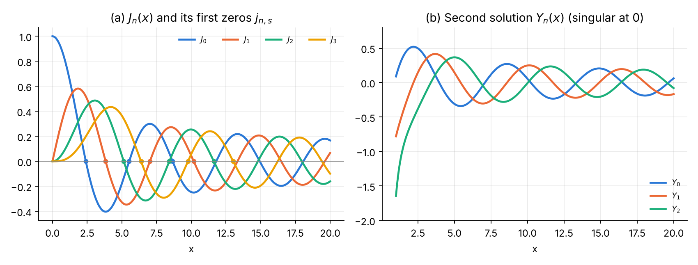
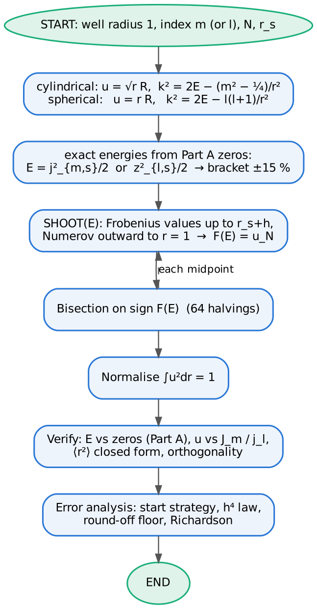
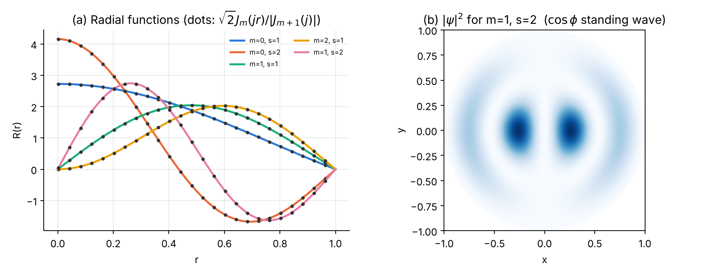
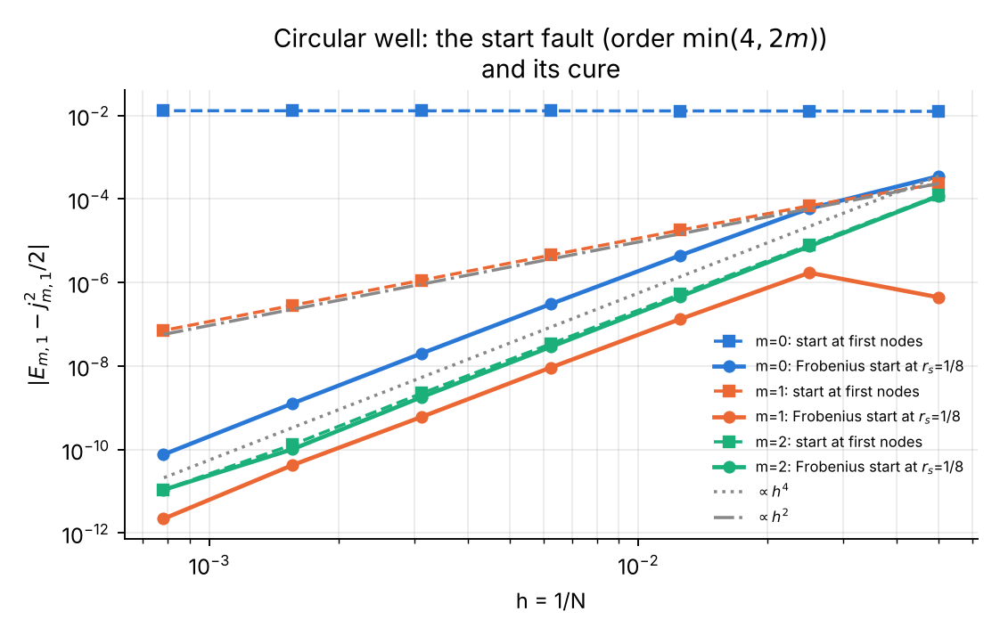

# Chapter 3 — Cylindrical Bessel functions and the circular well

## 3.1 The function

Bessel's equation of order $\nu$ [@DLMF, §10.2; @Watson, ch. 3]

$$
x^2y'' + x\,y' + (x^2-\nu^2)\,y = 0
$$

has the solution regular at the origin

$$
J_\nu(x) = \sum_{k=0}^\infty \frac{(-1)^k}{k!\,\Gamma(k+\nu+1)}\Big(\frac x2\Big)^{2k+\nu}
$$

and a second solution $Y_\nu$ that is singular at $x=0$ ($Y_0\sim\tfrac2\pi\ln x$, $Y_n\sim -\tfrac{(n-1)!}{\pi}(2/x)^n$). For integer $n$ [@DLMF, §10.6, §10.9, §10.12, §10.17, §10.21; @Watson; @Arfken, ch. 14; @AS, ch. 9]:

* Recurrences: $J_{n-1}+J_{n+1} = \tfrac{2n}{x}J_n$, $\ J_{n-1}-J_{n+1} = 2J_n'$.
* Integral representation (Bessel): $J_n(x) = \dfrac1\pi\displaystyle\int_0^\pi\cos(n\tau - x\sin\tau)\,d\tau$.
* Generating function and Jacobi–Anger expansion: $e^{ix\sin\phi} = \sum_n J_n(x)e^{in\phi}$, hence $1 = J_0 + 2\sum_{k\ge1}J_{2k}$ and $\cos x = J_0 - 2J_2 + 2J_4 - \dots$
* Asymptotics: $J_n(x)\approx\sqrt{2/\pi x}\cos(x - n\pi/2 - \pi/4)$ for $x\gg n$; $J_n(x)\approx (x/2)^n/n!$ for $x\ll\sqrt{n+1}$.
* Zeros $j_{n,s}$ (McMahon's expansion [@DLMF, §10.21(vi); @Watson, §15.53]): $j_{n,s}\approx\beta - \dfrac{\mu-1}{8\beta} - \dfrac{4(\mu-1)(7\mu-31)}{3(8\beta)^3}$, $\beta = (s+\tfrac n2-\tfrac14)\pi$, $\mu = 4n^2$.
* Orthogonality on $[0,1]$: $\displaystyle\int_0^1 J_n(j_{n,s}r)J_n(j_{n,s'}r)\,r\,dr = \tfrac12 J_{n+1}(j_{n,s})^2\,\delta_{ss'}$.

{width=100%}

## 3.2 The physics: circular infinite well

A particle confined to a disc of radius $a = 1$ (a "quantum corral" [@Crommie93], a cylindrical waveguide, a drum) obeys $-\tfrac12\nabla^2\psi = E\psi$ with $\psi=0$ at $r=1$. Separation $\psi = R(r)e^{im\phi}$ gives Bessel's equation in $kr$, $k = \sqrt{2E}$; regularity at the origin selects $J_m$ and the boundary condition gives

$$
E_{m,s} = \frac{j_{m,s}^2}{2},\qquad R_{m,s}(r) = \frac{\sqrt2\,J_m(j_{m,s}r)}{|J_{m+1}(j_{m,s})|}\quad\Big(\int_0^1R^2\,r\,dr = 1\Big).
$$

States with $m\neq0$ are doubly degenerate ($\pm m$). Exact check: $\langle r^2\rangle = \tfrac13 + \tfrac{2(m^2-1)}{3j_{m,s}^2}$ (follows from the Lommel integrals [@Watson, §5.11]).

## 3.3 Analytical scheme

**Part A — computing $J_n(x)$.**

1. Power series — accurate for small $x$, but its terms reach $\sim e^{x}/\sqrt{x}$ while the sum is $O(x^{-1/2})$: cancellation for large $x$.
2. Forward recurrence from $J_0, J_1$ — **unstable** for $n > x$ ($J_n$ is minimal [@Gautschi67]).
3. **Miller's algorithm** [@Miller52; @Olver64; @GST, ch. 4] (recommended): choose even $M > \max(n, x) + \sqrt{64\max(n,x)} + 10$, set $f_{M+1}=0$, $f_M = 10^{-30}$, recur downwards with rescaling, normalise by $f_0 + 2\sum f_{2k}$.
4. Trapezoid rule on the Bessel integral: the integrand is smooth and periodic, so the trapezoid rule converges **geometrically** once the number of panels exceeds $\approx x + n$ [@GST, ch. 5].
5. Zeros: McMahon start, Newton with $J_n' = (J_{n-1}-J_{n+1})/2$.

**Part B — Numerov.** $u = \sqrt r\,R$:

$$
u'' + \Big[2E - \frac{m^2-\tfrac14}{r^2}\Big]u = 0,\quad u(1)=0,\quad
u = r^{m+1/2}\sum_k a_kr^{2k},\ \ 2k(2k+2m)\,a_k = -2E\,a_{k-1}.
$$

Outward shooting from the Frobenius values on $[0, r_s+h]$ ($r_s = 1/8$, or the first two nodes for comparison) to $r=1$; bisection on the sign of $F(E) = u_N(E)$ in $[0.85, 1.15]\times j_{m,s}^2/2$, with the zeros from Part A.

## 3.4 Logic chart

{width=55%}

## 3.5 Python 3 code

{{CODE:python:../python/ch3_bessel_circular.py}}

## 3.6 Fortran 2008 code

{{CODE:fortran:../fortran/ch3_bessel_circular.f90}}

## 3.7 Results, normalisation and verification

**Part A.**

| n | x | Miller | rel. error Miller | rel. error series |
|---:|---:|---:|---:|---:|
| 0 | 1 | 0.7651976865579666 | 0 | 0 |
| 5 | 10 | −0.2340615281867937 | 3.6e-16 | 3.9e-14 |
| 0 | 30 | −0.08636798358104024 | 3.2e-16 | 1.4e-04 |
| 3 | 50 | 0.09273480406163438 | 6.0e-16 | 2.9e+04 |
| 20 | 5 | 2.770330052128941e-11 | 3.5e-16 | 2.3e-16 |
| 50 | 1 | 2.906004948173239e-80 | 1.3e-16 | 1.3e-16 |

Forward recurrence at $x = 1$ (started from exact $J_0, J_1$): relative error $1.9\times10^{-11}$ at $n=5$, $8.2$ at $n=10$, $10^{64}$ at $n=30$; Miller stays at $4\times10^{-16}$. Independent checks: Jacobi–Anger identity satisfied to $4\times10^{-16}$ for $x = 0.5, 7.3, 25$; agreement with SciPy [@SciPy] `jv` ($5\times10^{-16}$) and with the Fortran intrinsic `bessel_jn` [@F2008] ($3\times10^{-16}$, $n\le10$, $0.1\le x\le40$). Zeros $j_{n,s}$ ($n\le3$, $s\le5$) agree with mpmath [@mpmath] to $\le 2\times10^{-15}$; e.g. $j_{0,1} = 2.404825557696$, $j_{1,1} = 3.831705970208$.

**Part B** ($N = 400$, $r_s = 1/8$):

| m | s | E Numerov | j²/2 (Part A) | \|ΔE\| | ∫u²dr | max\|u − u_ex\| | ⟨r²⟩ | exact |
|---:|---:|---:|---:|---:|---:|---:|---:|---:|
| 0 | 1 | 2.891592973150 | 2.891592981473 | 8.3e-09 | 1.000000000000 | 1.7e-09 | 0.218057 | 0.218057 |
| 0 | 2 | 15.235631154365 | 15.235631171831 | 1.7e-08 | 1.000000000000 | 2.2e-09 | 0.311455 | 0.311455 |
| 0 | 3 | 37.443503350309 | 37.443503395348 | 4.5e-08 | 1.000000000000 | 1.9e-09 | 0.324431 | 0.324431 |
| 1 | 1 | 7.340985321312 | 7.340985321062 | 2.5e-10 | 1.000000000000 | 1.2e-10 | 0.333333 | 0.333333 |
| 1 | 2 | 24.609228154294 | 24.609228160847 | 6.6e-09 | 1.000000000000 | 4.3e-10 | 0.333333 | 0.333333 |
| 2 | 1 | 13.187308212838 | 13.187308213582 | 7.4e-10 | 1.000000000000 | 4.9e-11 | 0.409164 | 0.409164 |
| 3 | 1 | 20.353232907800 | 20.353232909100 | 1.3e-09 | 1.000000000000 | 1.8e-10 | 0.464353 | 0.464353 |

Orthogonality of the $m=0$ states: $7.5\times10^{-10}$. (Note $\langle r^2\rangle = 1/3$ exactly for every $m=1$ state — a nice check of the formula.)

{width=100%}

## 3.8 Error analysis and convergence

{width=100%}

| N | m=0 first nodes | m=0 r_s=1/8 | m=1 first nodes | m=1 r_s=1/8 | m=2 first nodes | m=2 r_s=1/8 |
|---:|---:|---:|---:|---:|---:|---:|
| 20 | 1.25e-02 | 3.51e-04 | 2.34e-04 | 4.42e-07 | 1.22e-04 | 1.17e-04 |
| 40 | 1.27e-02 | 5.90e-05 | 6.85e-05 | 1.71e-06 | 7.99e-06 | 7.35e-06 |
| 80 | 1.28e-02 | 4.44e-06 | 1.79e-05 | 1.33e-07 | 5.23e-07 | 4.60e-07 |
| 160 | 1.29e-02 | 3.06e-07 | 4.51e-06 | 9.23e-09 | 3.41e-08 | 2.88e-08 |
| 320 | 1.29e-02 | 2.01e-08 | 1.13e-06 | 6.07e-10 | 2.22e-09 | 1.81e-09 |
| 640 | 1.29e-02 | 1.27e-09 | 2.83e-07 | 4.25e-11 | 1.31e-10 | 1.02e-10 |
| 1280 | 1.30e-02 | 7.57e-11 | 7.08e-08 | 2.19e-12 | 1.08e-11 | 1.08e-11 |
| **order** | **0.0** | **3.9** | **2.0** | **3.8** | **4.0** | **4.0** |

{width=72%}

At $N=20$ the $m=1$ entry with $r_s = 1/8$ ($4.4\times10^{-7}$) is accidentally small (errors of opposite sign cancel); the asymptotic $h^4$ behaviour starts at $N=40$. **Richardson** [@Richardson27] ($m=0$): $E(1/160) = 2.891592675486$, $E(1/320) = 2.891592961368$, $E_R = 2.891592980427$, error $1.0\times10^{-9}$ — a factor 20 better than the finer grid.

## 3.9 Exercises

1. **McMahon's expansion** [@DLMF, §10.21(vi)]. Compare the one-term ($\beta$) and two-term approximations with the exact zeros of $J_0$ for $s = 1, 5, 20$. *Answer:* one-term errors $4.9\times10^{-2}$, $8.4\times10^{-3}$, $2.0\times10^{-3}$; two-term errors $4.4\times10^{-3}$, $2.4\times10^{-5}$, $3.4\times10^{-7}$ — an asymptotic expansion in $1/\beta$.
2. **Miller's starting index.** Find empirically the smallest $M$ that gives $J_5(10)$ to $10^{-13}$, and compare with the Numerical-Recipes rule $M\approx 2\big[(n+\sqrt{40n})/2\big]$ [@NR, §6.5; @Olver64]. *Answer from the plot:* $M\approx 30$.
3. **Annular well** $0.5 < r < 1$ (both walls hard), $m = 0$. Show that the eigenvalue condition is $J_0(ka)Y_0(k) - J_0(k)Y_0(ka) = 0$, and that for a thin annulus $k_1\approx\pi/(1-a)$. Then solve it with Numerov — no special start is needed, since $r=0$ is excluded. *Answer:* $k_1 = 6.246061839$, $E = 19.5066442$ (thin-annulus estimate $k = 6.283$).
4. **Fault theory** [@BO, ch. 3]. For $m=1$, show that the ratio of the regular to the irregular solution at $r = h$ is $h^2$, and explain the observed order 2.
5. **Degeneracies** [@Crommie93]. List the first ten levels of the circular well with their degeneracy (1 for $m=0$, 2 otherwise) and compare with the spectrum of a square box of the same area.
