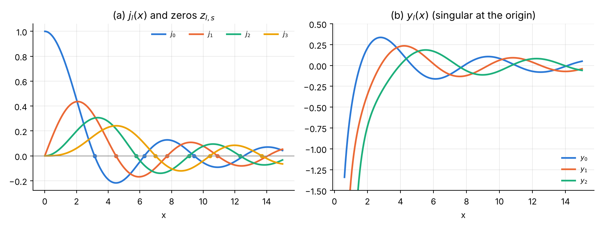
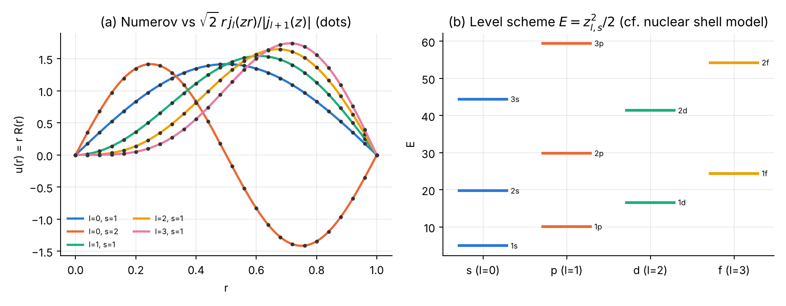
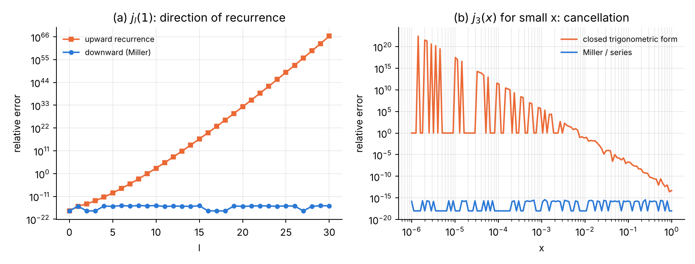
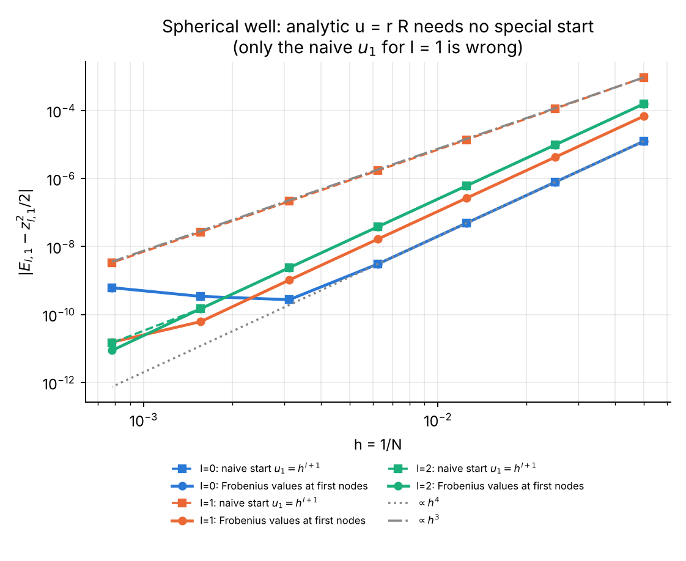

# Chapter 4 — Spherical Bessel functions and the spherical well

## 4.1 The function

The spherical Bessel functions solve [@DLMF, §10.47]

$$
x^2y'' + 2x\,y' + [x^2 - l(l+1)]\,y = 0,
\qquad j_l(x) = \sqrt{\frac{\pi}{2x}}\,J_{l+1/2}(x),\quad y_l(x) = \sqrt{\frac{\pi}{2x}}\,Y_{l+1/2}(x).
$$

Main properties [@DLMF, §10.49–§10.53, §10.60; @Arfken, §14.7; @Messiah, App. B; @AS, ch. 10]:

* Elementary closed forms: $j_0 = \dfrac{\sin x}{x}$, $j_1 = \dfrac{\sin x}{x^2} - \dfrac{\cos x}{x}$, $y_0 = -\dfrac{\cos x}{x}$, $y_1 = -\dfrac{\cos x}{x^2} - \dfrac{\sin x}{x}$; in general (Rayleigh) $j_l = (-x)^l\big(\tfrac1x\tfrac{d}{dx}\big)^l\tfrac{\sin x}{x}$.
* Recurrence (for both $j_l$ and $y_l$): $f_{l+1} = \dfrac{2l+1}{x}f_l - f_{l-1}$; derivative $j_l' = j_{l-1} - \tfrac{l+1}{x}j_l$.
* Small-$x$ series: $j_l(x) = \dfrac{x^l}{(2l+1)!!}\Big[1 - \dfrac{x^2}{2(2l+3)} + \dots\Big]$.
* Cross product: $j_l(x)\,y_{l-1}(x) - j_{l-1}(x)\,y_l(x) = x^{-2}$ [@DLMF, §10.50].
* Plane-wave expansion: $e^{ikz} = \sum_l i^l(2l+1)j_l(kr)P_l(\cos\theta)$ [@DLMF, §10.60] — the basis of partial-wave scattering theory [@Sakurai, §6.4].
* Zeros $z_{l,s}$ of $j_l$: $z_{0,s} = s\pi$; they interlace and determine the spectrum of the spherical well.

{width=100%}

## 4.2 The physics: spherical infinite well

For $V = 0$ inside a sphere of radius 1 and an infinite wall at $r=1$ [@Griffiths, §4.1; @LL, §33], $\psi = R(r)Y_{lm}$, $u = rR$:

$$
u'' + \Big[2E - \frac{l(l+1)}{r^2}\Big]u = 0,\qquad u(0) = u(1) = 0,\qquad
E_{l,s} = \frac{z_{l,s}^2}{2},\quad R = \frac{\sqrt2\,j_l(z_{l,s}r)}{|j_{l+1}(z_{l,s})|}.
$$

Each level is $(2l+1)$-fold degenerate. This is the simplest model of a nucleus or a quantum dot: the level order $1s, 1p, 1d, 2s, 1f, 2p, 1g,\dots$ and the cumulative occupancies $2, 8, 18, 20, 34, 40, 58, 68, 90, 92, \dots$ reproduce the first nuclear magic numbers 2, 8, 20 and, after the spin–orbit splitting is added, 28, 50, 82, 126 [@Mayer49; @HJS49; @BM, ch. 2].

## 4.3 Analytical scheme

**Part A.**

1. Upward recurrence from the closed forms — **stable for $y_l$**, **unstable for $j_l$ when $l > x$** ($j_l$ is minimal [@Gautschi67; @GST, ch. 4]).
2. **Miller's algorithm for $j_l$** [@Miller52; @NR, §6.7]: start at $M = l + x + 20 + \sqrt{40(l+x)}$, recur downwards, normalise with $j_0 = \sin x/x$ (or with $j_1$ where $j_0$ is near a zero).
3. For $x<10^{-3}$: the series — the closed forms suffer catastrophic cancellation (e.g. $j_3$ is a difference of terms of size $x^{-4}$ whose result is $x^3/105$).
4. Zeros: scan with step 0.1, then Newton.

**Part B.** Numerov for $u = rR$ with Frobenius series $u = r^{l+1}\sum a_kr^{2k}$, $2k(2k+2l+1)a_k = -2Ea_{k-1}$, evaluated at the first nodes (here $u$ is analytic, so this is sufficient), compared with the naive start $u_1 = h^{l+1}$; outward shooting and bisection as in Chapter 3.

## 4.4 Logic chart

See the logic chart of Section 3.4: the program is identical except for $k^2$, the Frobenius recurrence and the exact solution.

## 4.5 Python 3 code

{{CODE:python:../python/ch4_spherical_bessel_well.py}}

## 4.6 Fortran 2008 code

{{CODE:fortran:../fortran/ch4_spherical_bessel_well.f90}}

## 4.7 Results, normalisation and verification

**Part A.**

| l | x | j_l (Miller) | rel. error Miller | rel. error upward recurrence |
|---:|---:|---:|---:|---:|
| 2 | 5 | 0.1347312100851252 | 0 | 0 |
| 5 | 1 | 9.256115861125814e-05 | 1.5e-16 | 4.4e-10 |
| 10 | 2 | 6.825300864974727e-08 | 1.9e-16 | 1.8e-04 |
| 20 | 30 | −0.01471159335342906 | 2.1e-15 | 5.9e-16 |
| 30 | 1 | 5.566831266981347e-43 | 1.4e-16 | 2.2e+66 |
| 3 | 10⁻⁴ | 9.523809518518520e-15 | 0 | 3.5e+11 |

$y_l$ by upward recurrence is accurate to $3\times10^{-16}$ even for $y_{30}(1)\approx-2.9\times10^{40}$. The cross product $x^2(j_ly_{l-1}-j_{l-1}y_l) = 1$ holds to $7\times10^{-16}$ for $l\le25$ and $x = 0.5, 3, 20$ — an independent check that needs no reference software. Agreement with SciPy [@SciPy] `spherical_jn`: $1.4\times10^{-15}$. Zeros (e.g. $z_{1,1} = 4.493409457909$, $z_{2,1} = 5.763459196895$) agree with mpmath [@mpmath] to $\le2\times10^{-15}$.

**Part B** ($N = 400$, Frobenius start):

| l | s | E Numerov | z²/2 (Part A) | \|ΔE\| | ∫u²dr | max\|u − u_ex\| | ⟨r²⟩ | exact |
|---:|---:|---:|---:|---:|---:|---:|---:|---:|
| 0 | 1 | 4.934802200474 | 4.934802200545 | 7.1e-11 | 1.000000000000 | 5.2e-11 | 0.282673 | 0.282673 |
| 0 | 2 | 19.739208797098 | 19.739208802179 | 5.1e-09 | 1.000000000000 | 7.6e-12 | 0.320668 | 0.320668 |
| 1 | 1 | 10.095364277786 | 10.095364278213 | 4.3e-10 | 1.000000000000 | 2.3e-11 | 0.374606 | 0.374606 |
| 1 | 2 | 29.839757959217 | 29.839757972055 | 1.3e-08 | 1.000000000000 | 3.0e-10 | 0.347297 | 0.347297 |
| 2 | 1 | 16.608730956157 | 16.608730957134 | 9.8e-10 | 1.000000000000 | 1.1e-10 | 0.438700 | 0.438700 |
| 3 | 1 | 24.415596820069 | 24.415596821810 | 1.7e-09 | 1.000000000000 | 2.5e-10 | 0.486924 | 0.486924 |

(The exact $\langle r^2\rangle$ was obtained by 50-digit quadrature of $j_l^2$.) Orthogonality between states of equal $l$: $1.5\times10^{-11}$.

{width=100%}

## 4.8 Error analysis and convergence

{width=100%}

| N | l=0 naive | l=0 Frobenius | l=1 naive | l=1 Frobenius | l=2 naive | l=2 Frobenius |
|---:|---:|---:|---:|---:|---:|---:|
| 20 | 1.25e-05 | 1.25e-05 | 9.37e-04 | 6.79e-05 | 1.57e-04 | 1.57e-04 |
| 40 | 7.83e-07 | 7.82e-07 | 1.13e-04 | 4.23e-06 | 9.76e-06 | 9.76e-06 |
| 80 | 4.89e-08 | 4.89e-08 | 1.38e-05 | 2.64e-07 | 6.10e-07 | 6.10e-07 |
| 160 | 3.05e-09 | 3.05e-09 | 1.71e-06 | 1.65e-08 | 3.81e-08 | 3.81e-08 |
| 320 | 2.71e-10 | 2.71e-10 | 2.13e-07 | 1.03e-09 | 2.38e-09 | 2.38e-09 |
| 640 | 3.40e-10 | 3.40e-10 | 2.66e-08 | 6.15e-11 | 1.48e-10 | 1.48e-10 |
| 1280 | 6.13e-10 | 6.13e-10 | 3.34e-09 | 1.53e-11 | 1.46e-11 | 8.76e-12 |
| **order** | **3.85** | **3.85** | **3.01** | **4.01** | **3.91** | **4.01** |

{width=72%}

Observations:

* For $l=0$ the naive and Frobenius starts coincide: with $u_0=0$ the second start value only fixes the scale.
* The $l=0$ error stops decreasing at $\approx3\times10^{-10}$ and then grows: this is the **round-off floor** $\sim\epsilon N^2$ already met in Exercise 1 of the first course (the eigenvalue is determined by the sign of $u_N$, which is a small difference of large accumulated quantities).
* **Richardson** [@Richardson27] ($l=1$): $E(1/80) = 10.095364013952$, $E(1/160) = 10.095364261698$, $E_R = 10.095364278214$, error $7.5\times10^{-13}$ (direct error on the finer grid: $1.7\times10^{-8}$).
* Compared with Chapter 3: same equation type, same method — but the spherical problem has no start fault because the Liouville transformation $u = rR$ keeps the solution analytic, whereas $u=\sqrt rR$ does not.

## 4.9 Exercises

1. **Rayleigh's formula** [@DLMF, §10.49; @Arfken, §14.7]. Derive $j_2$ and $y_2$ in closed form from Rayleigh's formula, and check the cross product $j_2y_1 - j_1y_2 = x^{-2}$ symbolically.
2. **Where does the upward recurrence fail?** [@Gautschi67] Show that the relative error of upward $j_l(x)$ grows roughly like $\big|y_l(x)/j_l(x)\big|\,\epsilon$ and compare with the table ($l = 10$, $x = 2$: $|y_{10}/j_{10}| = 5\times10^{12}$, so the predicted error is $\approx5\times10^{-4}$; observed $1.8\times10^{-4}$).
3. **Finite spherical well (deuteron model)** [@Krane, ch. 4; @Griffiths, §4.1]. For $V = -V_0$ ($r<1$), $V_0 = 20$, $l=0$, derive the condition $q\cot q = -\kappa$, $q = \sqrt{2(V_0-|E|)}$, $\kappa = \sqrt{2|E|}$, solve it, and reproduce the result with Numerov using the discontinuity treatment of the first course (Problem 2) [@Course1]. *Answer:* two bound states, $E = -16.3537992$ and $E = -5.9978397$.
4. **Shell model** [@Mayer49; @HJS49; @BM, ch. 2]. Using the zeros from Part A, order the levels $z_{l,s}$ and compute the cumulative occupancy $\sum 2(2l+1)$. *Answer:* $1s(3.142), 1p(4.493), 1d(5.763), 2s(6.283), 1f(6.988), 2p(7.725), 1g(8.183), 2d(9.095), 1h(9.356), 3s(9.425)$; occupancies 2, 8, 18, 20, 34, 40, 58, 68, 90, 92.
5. **Partial-wave check** [@DLMF, §10.60]. Verify numerically $\sum_{l=0}^{L}(2l+1)j_l(x)^2 \to 1$ as $L\to\infty$ for $x = 5$ and $x = 30$; how large must $L$ be? *Answer:* the terms decay rapidly once $l > x$: for $x = 5$ the defect $1-\sum$ is $2\times10^{-7}$ at $L = 10$ and $10^{-14}$ at $L=15$; for $x = 30$ it is $1.3\times10^{-4}$ at $L=35$, $5\times10^{-8}$ at $L=40$ and at round-off level for $L = 50$.
