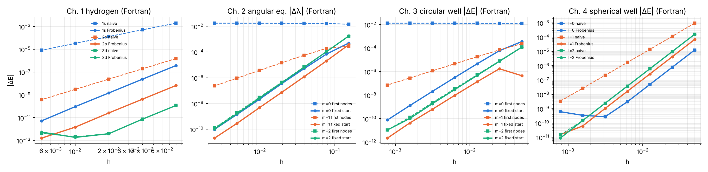

# Chapter 5 — Cross-check of the Fortran and Python implementations

The four Fortran 2008 programs implement exactly the same algorithms as the Python programs (same recurrences, same Frobenius series, same grids, same start index $j_s = \mathrm{nint}(r_s/h)$, same bisection counts). All tables in Chapters 1–4 are reproduced by the Fortran codes to every printed digit; the only differences are at the round-off level (last digit of numbers below $10^{-12}$). In addition, the Fortran versions use independent references that are unavailable in pure Python: the Fortran 2008 intrinsic `bessel_jn` [@F2008; @MRC] (agreement with Miller's algorithm: $2.8\times10^{-16}$ for $n\le10$, $0.1\le x\le40$), and the exact value $|J_m(j_{m,1})|\le2\times10^{-16}$ at the computed zeros.

The Fortran programs write their convergence data to `ch1_f_conv.dat` … `ch4_f_conv.dat`; `plot_fortran_results.py` produces the following figure.

{width=100%}

**Pitfalls met while writing the Fortran versions** (worth knowing for any Fortran work):

* Fortran is case-insensitive [@MRC]: a variable `dP` silently shadows the kind parameter `dp`, and `N` and `n`, `Ex` and `ex` are the same name. All three occurred and were caught by the compiler.
* Array constructors cannot be indexed directly (`[1,2,3](i)` is illegal) — use a named array.
* The rounding of $r_s/h = 12.5$ differs between Python's `round` (to even: 12) and Fortran's `nint` (away from zero: 13); the Python codes use `int(x + 0.5)` to match.

# Summary

| | Laguerre / hydrogen | Legendre / angular | Bessel $J_m$ / circular well | spherical Bessel / spherical well |
|---|---|---|---|---|
| Stable way to compute the function | forward recurrence | forward (normalised) recurrence | Miller (backward) | Miller for $j_l$, forward for $y_l$ |
| What fails | explicit sum (cancellation) | explicit sum; unnormalised overflow | power series; forward recurrence $n>x$ | upward $j_l$; closed forms at small $x$ |
| Gauss rule / zeros | Gauss–Laguerre (Newton, Golub–Welsch) | Gauss–Legendre | McMahon + Newton | scan + Newton |
| Liouville variable | $u = rR$ (analytic) | $u=\sqrt{\sin\theta}\,\Theta$ (not analytic) | $u=\sqrt r R$ (not analytic) | $u = rR$ (analytic) |
| Shooting | two-sided, turning point | two-sided, both poles | outward, $u(1)=0$ | outward, $u(1)=0$ |
| Start fault | naive start: order 2 (s), 3 (p) | first nodes: order $\min(4,2m)$, none for $m=0$ | first nodes: order $\min(4,2m)$ | naive start: order 3 for $l=1$ |
| Cure | Frobenius series | Frobenius up to fixed $\theta_s$ | Frobenius up to fixed $r_s$ | Frobenius values |
| Accuracy reached | $10^{-13}$ | $10^{-11}$ | $10^{-11}$ | $10^{-11}$ |

Key messages:

1. **Recurrences are the method of choice — in the stable direction.** Dominant solutions forwards, minimal solutions backwards (Miller). Explicit sums and closed forms are for small arguments only.
2. **Always verify with an identity that does not use the code being tested**: Jacobi–Anger, cross products, sums of weights, orthogonality, virial theorem.
3. **Separation of variables gives singular ODEs.** Numerov keeps its fourth order only if the solution is smooth on the integration interval: start from a Frobenius series at a fixed point, never at the first grid nodes of a non-analytic solution.
4. **A calculation can converge perfectly in $h$ and still be wrong** (angular equation, $m=0$: error $1.7\times10^{-2}$ for every $h$). Convergence studies are necessary, not sufficient; comparison with an exact limit is indispensable.
5. Richardson extrapolation and Gauss quadrature are cheap ways to gain digits — provided the error model ($h^4$, analyticity) actually holds.

# References

{{BIBLIOGRAPHY}}
